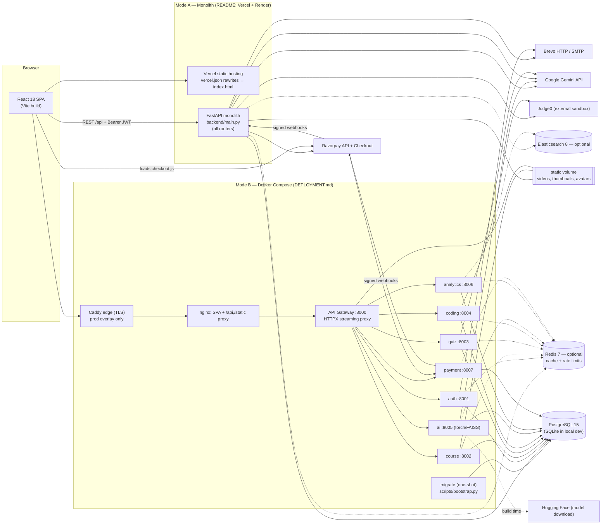
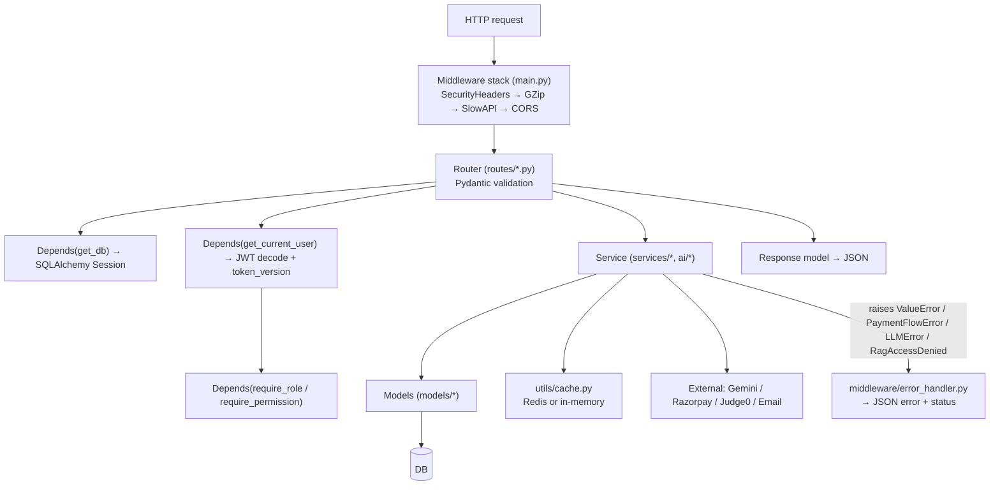
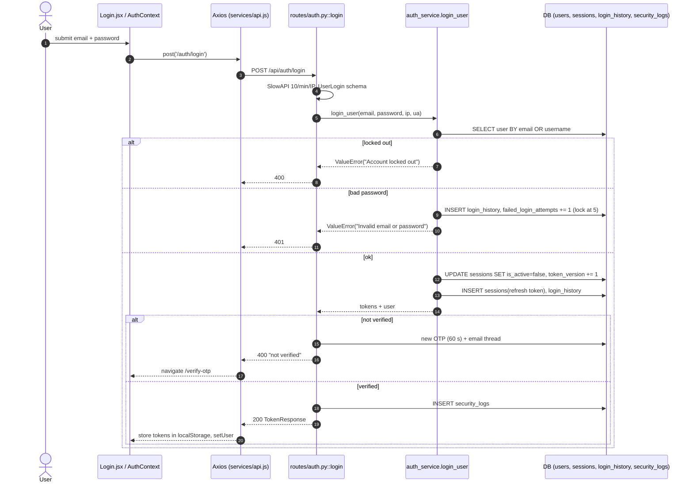
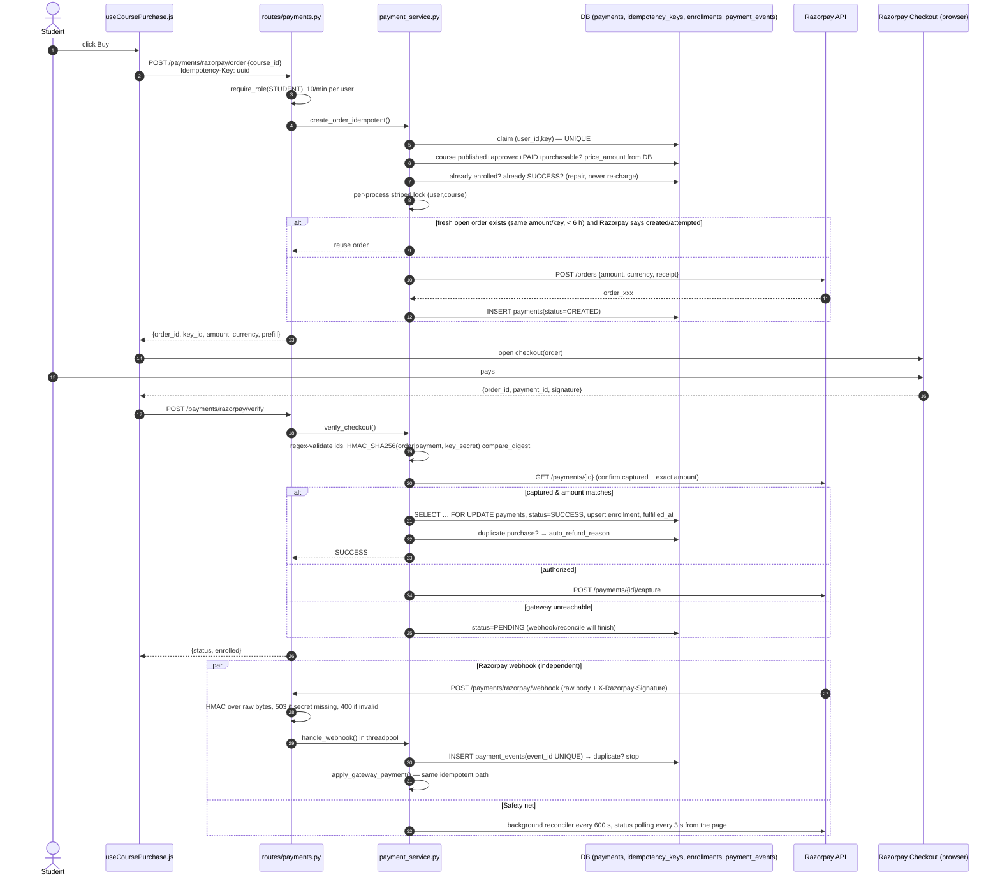
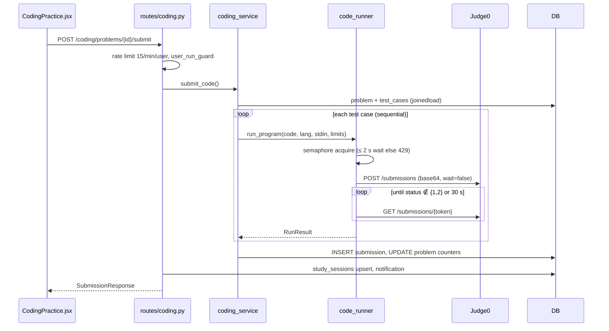
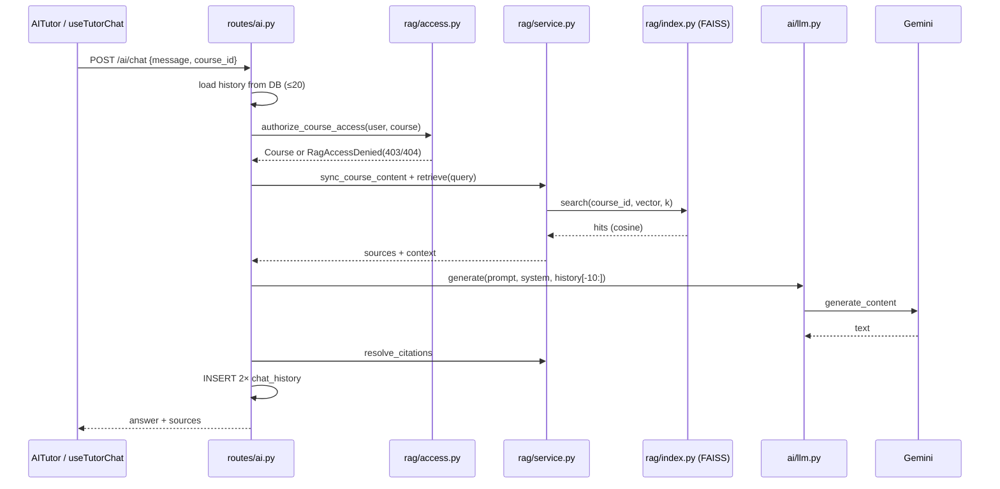
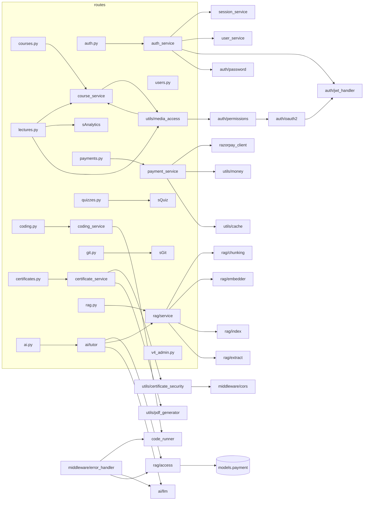
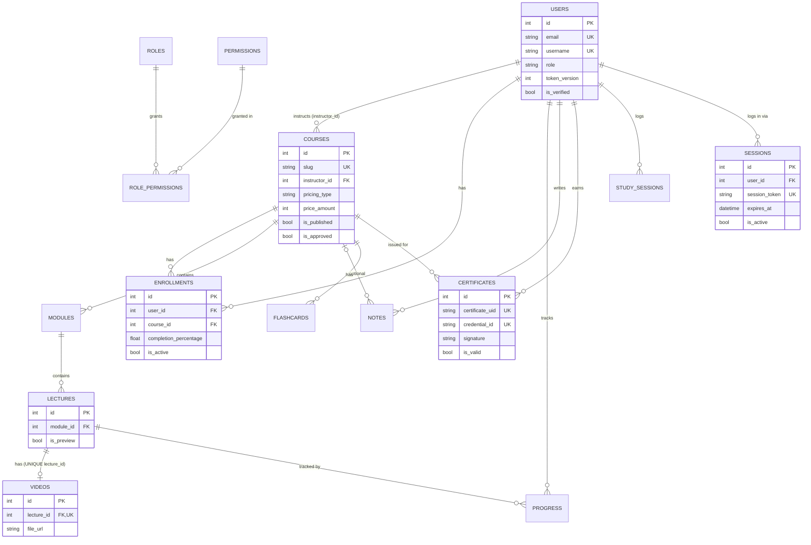
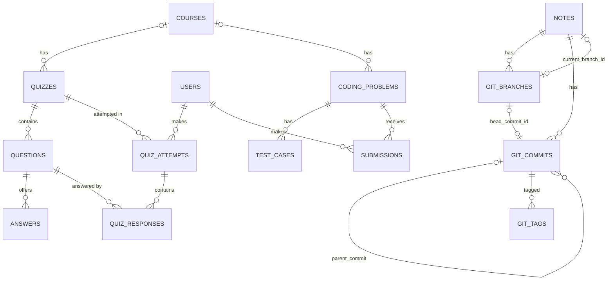
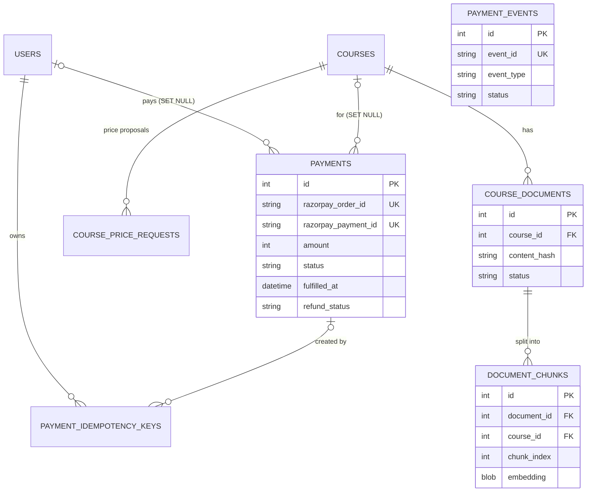

# Codexia Academy — Project Interview Guide

> A study guide built from reading the actual code in this repository (backend, frontend, infrastructure, tests).
> Every claim points to a file. Anything that could not be verified from the repository is marked as such.
>
> **Labels used throughout**
> - ✅ **Implemented** — working code exists and is wired in.
> - 🟡 **Partial** — exists but incomplete, inconsistent, or only works in some paths.
> - ⚙️ **Configured, not used** — a dependency, setting, table or file that nothing uses.
> - ❌ **Missing** — not in the repository.
> - 🔎 **Inference** — my reasoning about *why*, not something the code or docs state.
> - **Confirmed** = I verified it in code (and sometimes by running it). **Possible risk** = depends on runtime/config I could not see.

---

## Table of contents

0. [Analysis status and inventory](#0-analysis-status-and-inventory)
1. [Executive summary](#1-executive-summary)
2. [Project introduction for interviews](#2-project-introduction-for-interviews)
3. [Technology stack](#3-technology-stack)
4. [Directory and file structure](#4-directory-and-file-structure)
5. [Architecture overview](#5-architecture-overview)
6. [Architecture diagrams](#6-architecture-diagrams)
7. [Important request flows](#7-important-request-flows)
8. [Module-by-module explanations](#8-module-by-module-explanations)
9. [Database schema and ER diagram](#9-database-schema-and-er-diagram)
10. [Important queries and data flows](#10-important-queries-and-data-flows)
11. [Authentication and security](#11-authentication-and-security)
12. [Design patterns and engineering principles](#12-design-patterns-and-engineering-principles)
13. [Technology comparisons and alternatives](#13-technology-comparisons-and-alternatives)
14. [Performance and scalability](#14-performance-and-scalability)
15. [Testing and code quality](#15-testing-and-code-quality)
16. [Deployment and production readiness](#16-deployment-and-production-readiness)
17. [Technical limitations and risks](#17-technical-limitations-and-risks)
18. [Improvement roadmap](#18-improvement-roadmap)
19. [Interview questions and answers](#19-interview-questions-and-answers)
20. [Final revision cheat sheet](#20-final-revision-cheat-sheet)
21. [Glossary](#21-glossary)
22. [Final verification report](#22-final-verification-report)

---

## 0. Analysis status and inventory

### What was done

- Read every backend source module (routes, services, models, schemas, middleware, auth, AI/RAG, microservices, utils, scripts), all infrastructure files (Dockerfiles, compose files, nginx, Caddy, CI), and the core frontend files (routing, API client, auth, payments, video player, quiz, notes diff rendering, markdown rendering).
- **Ran the backend test suite** against a throwaway SQLite file, with every external service (Gemini, Razorpay, Brevo/SMTP, Judge0, Redis, Elasticsearch) blanked out, the same way CI does: **253 passed, 1 skipped** (the skip needs to download a real embedding model), 3 min 36 s.
- **Ran the frontend tests** (`npm test`): **14/14 markdown cases and 11/11 render checks passed**.
- **Ran one probe script** (in-memory SQLite only) to confirm a suspected bug: deleting a user who has ever logged in fails (see §11, finding S2).
- No project file was modified. `.env` values were never printed (only variable *names* were listed).

### Inventory

| Area | Files | Status |
|---|---|---|
| Backend entry, config, DB setup | `backend/main.py`, `config.py`, `database.py` | Analyzed |
| Middleware | `backend/middleware/*` | Analyzed |
| Auth | `backend/auth/*`, `routes/auth.py`, `services/auth_service.py`, `services/session_service.py`, `services/user_service.py` | Analyzed |
| Models (65 tables) | `backend/models/*` | Analyzed |
| Schemas | `backend/schemas/*` | Partially analyzed (the user, course, quiz and coding schemas were read; the rest were sampled) |
| Courses, lectures, video streaming | `routes/courses.py`, `routes/lectures.py`, `services/course_service.py`, `utils/media_access.py` | Analyzed |
| Payments & pricing | `services/payment_service.py`, `services/razorpay_client.py`, `routes/payments.py`, `utils/money.py` | Analyzed; `pricing_service.py` and `routes/pricing.py` partially analyzed |
| Coding practice | `services/code_runner.py`, `services/coding_service.py`, `routes/coding.py`, `routes/v3_coding.py` | Analyzed |
| Quizzes & certificates | `services/quiz_service.py`, `routes/quizzes.py`, `services/certificate_service.py`, `utils/certificate_security.py`, `routes/certificates.py`, `routes/v3_certificates.py` | Analyzed (`utils/pdf_generator.py` not read line by line) |
| Git-style notes | `services/git_service.py`, `routes/git.py`, `models/git.py` | Analyzed (merge, ancestor search, diff, commit); PDF export not read |
| AI & RAG | `ai/llm.py`, `ai/tutor.py`, `ai/rag/*`, `routes/ai.py`, `routes/v3_ai.py`, `routes/rag.py` | Analyzed; `ai/generator.py`, `ai/code_review.py` and the prompt files only sized and skimmed |
| Analytics, admin, search, comms | `services/analytics_service.py`, `routes/v4_admin.py`, `routes/admin.py`, `routes/v3_*` | Partially analyzed (security-relevant and hot paths read; `search_service.py` and `elasticsearch_client.py` only skimmed) |
| Microservices | `microservices/gateway/main.py`, `microservices/shared/factory.py`, each `*/main.py` | Analyzed |
| Seeding/bootstrap | `seed_db.py`, `scripts/bootstrap.py` | Partially analyzed (logic read, not the seed content); `seed_coding_problems.py` and `seed_scratch_problems.py` are data files that I did not read |
| Tests | `backend/tests/*`, `frontend/scripts/*` | Analyzed (fixtures, and counts by running them) |
| Frontend app shell & data layer | `App.jsx`, `index.jsx`, `services/*`, `context/*`, `hooks/useCoursePurchase.js`, `hooks/useQueries.js`, `utils/razorpay.js` | Analyzed |
| Frontend pages (33) | `src/pages/*` | Partially analyzed (Login, VideoPlayer, Quiz, Notes diff view and the purchase flow read; the other large pages, e.g. `InstructorDashboard.jsx` at 2,186 lines, were only scanned) |
| CSS | `src/styles/*` | Not analyzed (not relevant to interviews) |
| Infrastructure & CI | Dockerfiles, compose, nginx, Caddy, `.github/workflows/ci.yml`, `vercel.json` | Analyzed |
| Live production (Render/Vercel/DB) | — | Not applicable / cannot be verified from the repo |

---

## 1. Executive summary

**Codexia Academy** is a full-stack learning management system (LMS). Students watch video courses, chat with a course-aware AI tutor, solve coding problems in six languages, keep Markdown notes with Git-style version control, take quizzes, earn verifiable PDF certificates, and buy paid courses through Razorpay. Instructors build courses; admins manage users, pricing, payments and the platform.

**How it is built**

- **Backend:** Python + **FastAPI**, **SQLAlchemy 2.0** ORM, **Pydantic v2** validation. The code is organised in layers: `routes/` (HTTP) → `services/` (business logic) → `models/` (database).
- **One codebase, two ways to deploy it:**
  1. **Monolith** — `backend/main.py` mounts every router in one process. This is what the README says runs on Render.
  2. **Microservices** — `docker-compose.yml` runs the same code as 7 services plus an **API gateway** (`microservices/gateway/main.py`), all sharing **one PostgreSQL database**.
- **Frontend:** **React 18** single-page app (SPA) built with **Vite**, with **React Router**, **TanStack Query** (server-state caching), **Axios** (with automatic token refresh), the **Monaco** editor and **react-markdown + KaTeX**.
- **Data:** PostgreSQL in production, SQLite by default in local development. Optional **Redis** (cache and rate-limit counters, with an in-memory fallback) and **Elasticsearch** (search, falling back to SQL `ILIKE`).
- **External services:** Google **Gemini** (LLM), **Razorpay** (payments), **Judge0** (sandboxed code execution), **Brevo/SMTP** (email), Hugging Face (embedding model download).

**The strongest engineering in the project**

1. **The payment pipeline** (`services/payment_service.py`): the price always comes from the database, HMAC signatures are checked on checkout and on webhooks, idempotency keys and unique webhook event IDs make retries safe, row locks protect state changes, a background reconciler repairs lost callbacks, and duplicate charges are refunded automatically.
2. **Course-grounded RAG** (`ai/rag/*`): authorization runs *before* any retrieval, each course has its own FAISS index rebuilt from rows in the database, and citations the model invents are removed.
3. **Isolated code execution** (`services/code_runner.py`): in production, student code runs only in Judge0. A local subprocess runner exists for development and refuses to start unless `DEBUG=true`.
4. **Signed, expiring video URLs** (`utils/media_access.py`): every request re-checks whether the viewer may watch.

**Most important problems found** (details in §11 and §18)

| # | Problem | Severity |
|---|---|---|
| S1 | An **admin can reset a super admin's password** (`PATCH /api/users/{id}/reset-password` never checks the target's role), which gives full takeover | P0 |
| S2 | **Deleting any user who has ever logged in fails** with an IntegrityError (confirmed by a probe script) | P0 (correctness) |
| S3 | **`DEBUG` defaults to `True`.** A production environment that forgets to set it skips the safety checks, seeds demo accounts with password `123456` (including a super admin), and enables the local code runner | P0 (configuration risk) |
| S4 | OTP emails are **printed to server logs** when email delivery fails or is not configured | P1 |
| S5 | **Lecture progress is reported by the client** (`watch_percentage ≥ 90` marks a lecture complete), so course completion and certificates can be faked | P1 |
| S6 | Quiz endpoints **don't check enrollment or payment**, and the quiz time limit is enforced only in the browser | P1 |
| S7 | Several queries run once per row in a loop (N+1), foreign-key columns have no indexes, and cache invalidation wipes broad prefixes on every video progress ping | P2 |

---

## 2. Project introduction for interviews

> Every sentence below is backed by code. There are no invented users, traffic or performance numbers, because none can be measured from the repository.

### 30-second version

"Codexia Academy is a full-stack learning platform I built with FastAPI, React and PostgreSQL. Beyond video courses, it has a course-aware AI tutor using Gemini with retrieval-augmented generation, a coding-practice environment that runs code in six languages through a sandboxed Judge0 service, Git-style version control for notes, verifiable certificates, and paid courses through Razorpay. The part I'm proudest of is the payment flow: it's idempotent, verifies every signature on the server, and reconciles lost callbacks automatically."

### 60-second version

"Codexia Academy is an AI-powered LMS with four roles: student, instructor, admin and super admin. The backend is FastAPI with SQLAlchemy and Pydantic, organised as routes, services and models. The same codebase can run as one monolith or as seven Docker services behind an API gateway that share one PostgreSQL database. The React frontend uses TanStack Query for caching and an Axios interceptor that refreshes JWTs automatically.

A few features have real engineering depth. The AI tutor checks that the student is enrolled and has paid *before* it retrieves any course material. Each course has its own FAISS vector index, built from embeddings stored in the database. Student code never runs on the API server in production; it goes to Judge0. Payments take the price from the database, never from the client, verify Razorpay's HMAC signatures, and use idempotency keys and a reconciliation loop so a closed browser tab or a lost webhook never leaves a student charged without access."

### 2-minute technical version

"The system is a React single-page app talking to a FastAPI REST API. Authentication uses short-lived JWT access tokens (15 minutes) and rotating refresh tokens stored as session rows. Each user has a `token_version` counter: bumping it on login, logout or password reset invalidates every token issued before. That's how I enforce a single active device.

The backend is layered. Routers handle HTTP and dependency injection: the DB session, the current user, role checks. Services hold the business rules. SQLAlchemy models define about 65 tables. One codebase has two deployment modes: `main.py` mounts every router as a monolith, and Docker Compose starts seven services plus an HTTPX streaming gateway that routes by the first path segment. A one-shot migrate job creates the schema before any service starts.

Three subsystems are the most interesting. **Payments:** the server creates the Razorpay order from the database price, verifies the checkout signature, then fetches the payment from Razorpay to confirm it was captured for the exact amount before granting enrollment. Webhooks are verified over the raw body and deduplicated by event ID, state changes take row locks (`SELECT … FOR UPDATE` on PostgreSQL), and a background thread reconciles open payments. **RAG:** course content and uploaded PDFs are chunked by heading with overlap, embedded with Sentence-Transformers, and stored in the database; per-course FAISS indexes are a rebuildable cache, and the answer's citations are checked against the sources actually retrieved. **Code execution:** Judge0 runs code with CPU, memory and network limits, and the API adds per-user single-flight and a global concurrency semaphore.

There are trade-offs and things I'd fix. Schema changes use `create_all` plus a hand-written column list instead of Alembic. Lecture progress is trusted from the client. And the 'microservices' share one database, so they are really a modular monolith deployed as separate processes."

> **Tip:** if you claim microservices, be ready for "Do your services own their data?" The honest answer is **no**: they share one database and one model package. See Q-B4 in §19.

---

## 3. Technology stack

| Technology | Actual usage (file) | Why it is used | Alternative | Trade-offs |
|---|---|---|---|---|
| **Python 3.11** | Docker base `python:3.11-slim` (`Dockerfile`, `backend/Dockerfile.service`) | Rich AI/ML ecosystem (torch, sentence-transformers, FAISS) in the same language as the API | Node.js, Go | Python is slower for CPU-bound work and has the GIL; the AI ecosystem is the deciding factor |
| **FastAPI 0.139** | `main.py`, all `routes/*` | Type hints → automatic validation and OpenAPI docs (`/api/docs`), dependency injection (`Depends`), sync and async endpoints | Django REST Framework, Flask | Less built in than Django (no admin, ORM or migrations bundled); you assemble those pieces yourself |
| **Uvicorn** | Docker `CMD uvicorn main:app --proxy-headers` | ASGI server for FastAPI | Gunicorn with Uvicorn workers, Hypercorn | Worker count is set via `WEB_CONCURRENCY` in compose; there is no process supervisor beyond Docker |
| **SQLAlchemy 2.0.51 ORM** | `database.py`, `models/*`, `db.query(...)` everywhere | Python classes for tables, relationships, portable between SQLite and PostgreSQL | Raw SQL, SQLModel, Django ORM, Prisma | Uses the older `db.query()` style; easy to write N+1 queries by accident (see §14) |
| **Pydantic v2 / pydantic-settings** | `schemas/*`, `config.py` | Request/response validation; settings loaded from `.env` with types | marshmallow, attrs | Error messages are FastAPI's 422 format; validators run on every request |
| **PostgreSQL 15** | `docker-compose.yml`, `DATABASE_URL` | Reliable relational database with transactions, row locks (`FOR UPDATE`) and constraints | MySQL, MongoDB | Needs a managed host; connection limits matter with many services (`max_connections=200`) |
| **SQLite** | Default `DATABASE_URL=sqlite:///./ai_lms.db` | Zero-setup local development and tests | Postgres in Docker for development | Doesn't enforce foreign keys unless enabled (this code doesn't enable them); `FOR UPDATE` is a no-op, so local behavior differs from production |
| **Redis 7** | `utils/cache.py`, SlowAPI storage | Shared response cache and rate-limit counters across workers | Memcached, in-process cache | Optional: falls back to a per-process in-memory dict; prefix invalidation uses `SCAN` |
| **Elasticsearch 8** | `utils/elasticsearch_client.py`, `services/search_service.py` | Fuzzy full-text search | PostgreSQL full-text search (`tsvector`), Meilisearch | Heavy (JVM); an optional compose profile; falls back to `ILIKE` |
| **JWT (python-jose, HS256)** | `auth/jwt_handler.py` | Stateless access tokens; each service verifies them locally with the shared secret | Server-side sessions with cookies, OAuth provider | Revoking tokens needs the extra `token_version` check (which this project adds) |
| **bcrypt (direct)** | `auth/password.py` (cost 12) | Slow, salted password hashing | Argon2id, scrypt | bcrypt only uses the first 72 bytes of a password; `passlib` is installed but unused ⚙️ |
| **SlowAPI** | `middleware/rate_limiter.py`; 14 decorated endpoints | Per-route rate limits | Rate limiting at nginx/Caddy, API gateway | No global default limit; `RATE_LIMIT_PER_MINUTE` is defined but unused ⚙️ |
| **HTTPX** | Razorpay client, Judge0 client, gateway proxy | Sync and async HTTP clients with timeouts; streaming in the gateway | requests, aiohttp | — |
| **Google Gemini (`google-generativeai` 0.7)** | `ai/llm.py` (model `gemini-2.5-flash`) | Hosted LLM; no GPU needed | OpenAI, Claude, self-hosted Llama | Cost and quota limits; vendor lock-in; no rate limit on AI endpoints (§11) |
| **Sentence-Transformers + FAISS (CPU)** | `ai/rag/embedder.py`, `ai/rag/index.py` | Local embeddings (`all-MiniLM-L6-v2`) and exact vector search | pgvector, Pinecone, a hosted embeddings API | torch adds ~2 GB to the image; one copy of the model per process |
| **pypdf, python-docx** | `ai/rag/extract.py` | Extract text from instructor uploads | Apache Tika, unstructured | — |
| **Judge0 CE (external)** | `services/code_runner.py` | Sandboxed execution with CPU, memory, process and network limits | Docker per run, Firecracker, Piston | An external dependency; each test case is a separate HTTP round trip with polling |
| **Razorpay REST API** | `services/razorpay_client.py` | Indian payment gateway (paise amounts, UPI) | Stripe, PayU | Webhooks and signatures must be handled carefully, which the project does |
| **ReportLab + qrcode** | `utils/pdf_generator.py` | Generate certificate PDFs and QR codes on the server | WeasyPrint (HTML→PDF), headless Chrome | Layout is written in code |
| **Brevo HTTP API / SMTP** | `utils/email_service.py` | Sending email from hosts that block SMTP ports | SES, SendGrid | Sends from daemon threads, with no queue or retry |
| **psutil** | `routes/v4_admin.py` `/admin/health` | CPU, memory and disk figures for the admin dashboard | Prometheus node exporter | Shows the host of one process only |
| **React 18.3** | `frontend/src/*` | Component-based SPA | Vue, Angular, Next.js | Client-side rendering only; the SEO of public pages is limited |
| **Vite 5** | `vite.config.js` | Fast dev server, proxies `/api`, manual vendor chunks | Create React App (deprecated), webpack | — |
| **React Router 6.26** | `App.jsx` | Client-side routing and the `ProtectedRoute` role guard | TanStack Router | Role checks in the browser are only for the UI; the server enforces the real rules |
| **TanStack Query 5** | `context/QueryProvider.jsx`, `hooks/useQueries.js` | Server-state caching (5-minute stale time), retries | Redux Toolkit Query, SWR | Some pages still fetch with `api` directly |
| **Axios** | `services/api.js` | Interceptors attach the token and refresh it on a 401, with a queue for parallel requests | fetch | Tokens are kept in `localStorage` (§11) |
| **Monaco Editor** | `@monaco-editor/react` | The VS Code editor for the coding page | CodeMirror | Large bundle (split out with `manualChunks`) |
| **react-markdown, remark-gfm/math, rehype-katex, KaTeX, react-syntax-highlighter** | `components/common/MarkdownContent.jsx` | Safe rendering of AI and markdown output (no `rehype-raw`) | marked + DOMPurify | — |
| **Docker / Docker Compose** | `Dockerfile*`, `docker-compose*.yml` | Reproducible images; local and production microservices stack | Kubernetes, bare VMs | Compose on one host is not highly available |
| **Nginx** | `frontend/nginx.conf` | Serves the SPA, proxies `/api` and `/static` to the gateway, gzip, caching headers | Caddy alone, a CDN | No CSP header for the SPA |
| **Caddy 2** | `deploy/Caddyfile` | Automatic HTTPS (Let's Encrypt) at the edge in production compose | Traefik, nginx + certbot | — |
| **GitHub Actions** | `.github/workflows/ci.yml` | Runs backend pytest (SQLite) and frontend tests and build on every push or PR | GitLab CI, CircleCI | No lint, type check, security scan or deploy step |
| **Render / Vercel** | README, `vercel.json`, `Dockerfile` comments | Free hosting for the API and the SPA | Fly.io, Railway, AWS | Render's free tier sleeps (cold starts) and its disk is ephemeral (uploads lost on redeploy 🔎) |
| **Pytest** | `backend/tests/*` | Unit and integration tests with FastAPI `TestClient` | unittest | — |
| **Alembic** | listed in `requirements-base.txt` | — | — | ⚙️ Installed, never used; there are no migration scripts |

---

## 4. Directory and file structure

Excludes `node_modules/`, `venv/`, `__pycache__/`, `.pytest_cache/`, `.ruff_cache/`, build output, `.env`, the local SQLite database `ai_lms.db`, and uploaded media/PDFs. None of the excluded secrets, databases or media files are tracked by git (checked with `git ls-files`).

```text
.
├── .github/workflows/ci.yml        # CI: backend pytest (SQLite) + frontend test & build
├── Dockerfile                      # Monolith image (Render), root build context
├── docker-compose.yml              # Microservices stack: postgres, redis, (elasticsearch), migrate, 7 services, gateway, frontend
├── docker-compose.prod.yml         # Production overlay: DEBUG off, required secrets, Caddy TLS edge, memory limits
├── deploy/Caddyfile                # Edge reverse proxy with automatic HTTPS
├── .env.example / .env.production.example   # Environment templates (names only; real .env is git-ignored)
├── README.md / DEPLOYMENT.md       # Docs (partly outdated — see §16)
├── backend/
│   ├── main.py                     # Monolith app factory: middleware, /static, all routers, startup hooks, health
│   ├── config.py                   # pydantic-settings Settings + validate_production_settings()
│   ├── database.py                 # Engine, SessionLocal, Base, get_db(), create_tables() + ad-hoc column migrations
│   ├── auth/                       # jwt_handler, password (bcrypt), oauth2 (current-user deps), permissions (RBAC deps)
│   ├── middleware/                 # cors, rate_limiter (SlowAPI), error_handler, security_headers, request_context
│   ├── models/                     # 16 files, 65 tables (SQLAlchemy declarative)
│   ├── schemas/                    # Pydantic request/response models
│   ├── routes/                     # 26 FastAPI routers (v1, "v3_*", "v4_*" generations)
│   ├── services/                   # Business logic: payments, auth, sessions, coding, code_runner, git, quiz, certificates, search, analytics…
│   ├── ai/                         # llm.py (Gemini wrapper), tutor.py, generator.py, code_review.py, code_helper.py
│   │   └── rag/                    # access (authz), extract, chunking, embedder, index (FAISS), service (ingest/retrieve)
│   ├── prompts/                    # Tutor and generator prompt templates
│   ├── microservices/
│   │   ├── gateway/main.py         # HTTPX streaming reverse proxy, routes by /api/<segment>
│   │   ├── shared/factory.py       # create_service_app(): same middleware + /health + /health/ready for each service
│   │   └── {auth,course,quiz,coding,ai,analytics,payment}_service/main.py   # each mounts a subset of routers
│   ├── utils/                      # cache, elasticsearch_client, email_service, media_access, certificate_security, pdf_generator, money, helpers, validators
│   ├── scripts/bootstrap.py        # One-shot migrate job: tables, roles, seed, first admin
│   ├── scripts/check_code_execution.py   # Post-deploy smoke test for Judge0 (6 cases × 6 languages)
│   ├── seed_db.py, seed_coding_problems.py, seed_scratch_problems.py   # Reference + demo data
│   ├── tests/                      # 13 pytest modules (254 collected incl. parametrized)
│   ├── requirements-base.txt / -rag.txt / -dev.txt / requirements.txt
│   └── Dockerfile, Dockerfile.service
└── frontend/
    ├── index.html, vite.config.js, package.json, vercel.json, nginx.conf, Dockerfile
    ├── public/sw.js                # ⚙️ Push-notification service worker — never registered by the app
    ├── scripts/markdown.test.mjs, render-check.mjs   # Frontend tests (Node scripts, no Jest)
    └── src/
        ├── index.jsx, App.jsx      # Providers + route table (lazy-loaded pages)
        ├── services/api.js         # Axios instance, token attach, 401 → refresh → retry queue
        ├── services/paymentService.js, codingService.js
        ├── context/                # AuthContext, ThemeContext, NotificationContext (20 s polling), QueryProvider
        ├── hooks/                  # useCoursePurchase (payment state machine), useQueries (TanStack), useTutorChat, useSpeechInput, useDebounce
        ├── pages/                  # 33 route-level pages
        ├── components/             # layout, common (ProtectedRoute, MarkdownContent…), ai, admin, payments, coding, certificates
        ├── utils/                  # razorpay.js (Checkout loader), markdown.js, money.js, validators, constants
        └── styles/
```

### Responsibilities of the most important files

| File | Why it exists / responsibility | Depends on | Depended on by | If removed or changed |
|---|---|---|---|---|
| `backend/main.py` | Builds the monolith: CORS → rate limiter → error handlers → GZip → security headers; mounts `/static`; registers 26 routers; startup = validate settings, `create_tables()`, start payment reconciler, recover RAG docs, seed DB, ensure admin; `/api/health` and `/api/health/ready` | `config`, `database`, `middleware/*`, `routes/*`, `services/payment_service`, `seed_db`, `scripts/bootstrap` | Uvicorn (`main:app`), tests (`from main import app`) | No monolith deployment; tests break |
| `backend/config.py` | Single typed source of configuration from env/`.env` (`../.env` and `.env`). `validate_production_settings()` fails fast on placeholder JWT secret, SQLite, localhost `FRONTEND_URL` — **only when `DEBUG` is false** | pydantic-settings | Almost every module | Changing defaults changes security posture (e.g., `DEBUG=True` default) |
| `backend/database.py` | Engine (pool 5+5, `pool_pre_ping`, `pool_recycle=180`), `SessionLocal`, `Base`, `get_db()` request-scoped session; `create_tables()` = `create_all` + hand-coded `ALTER TABLE ADD COLUMN` list + unique indexes + certificate backfill | `config`, `models` | Every route (via `Depends(get_db)`), bootstrap | Schema evolution breaks; sessions leak if `get_db` doesn't close |
| `backend/auth/oauth2.py` | `get_current_user` dependency: decode access JWT → load user → active? → `token_version` match | `jwt_handler`, `database`, `models.user` | Nearly all protected routes, `permissions.py` | Every protected endpoint is affected |
| `backend/auth/permissions.py` | `require_role(...)` (super_admin always passes), `require_permission(name)` (DB-driven RBAC), `is_owner_or_admin` | `oauth2`, `models.user` | Routes | Authorization model changes globally |
| `backend/services/payment_service.py` | The only place where money turns into access: order creation, idempotency keys, checkout verification, webhook processing, fulfilment, refunds, reconciliation | `razorpay_client`, `models.payment`, `models.course`, `utils.money`, `utils.cache` | `routes/payments.py`, `main.py` (reconciler), `ai/rag/access.py` (reads Payment) | Paid access breaks or becomes unsafe |
| `backend/services/code_runner.py` | Chooses Judge0 vs local runner, validates sizes/language, wraps sources (LeetCode-style harness), concurrency guards, health | `config`, httpx | `coding_service`, `routes/coding.py`, `error_handler`, `/health/ready` | Code execution stops or becomes unsafe |
| `backend/utils/media_access.py` | `PublicStaticFiles` (hides `/static/videos`), HMAC-signed stream URLs, `can_watch_lecture` | `config`, `course_service`, `permissions` | `main.py`, gateway, `routes/courses.py`, `routes/lectures.py` | Paid videos become downloadable by anyone |
| `backend/ai/rag/access.py` | Authorization *before* retrieval (owner/admin, or enrolled + paid) | models | `ai/tutor.py` | RAG could leak paid course content |
| `backend/microservices/gateway/main.py` | Streams requests to the owning service by path segment; aggregates readiness; 503 when a service is down | `config`, httpx, middleware | Frontend nginx in compose | Microservice mode unusable |
| `frontend/src/services/api.js` | Axios base URL resolution, bearer token, single-flight refresh with a queue, forced logout on "another device" | axios | Every page/hook | All API calls / session renewal break |
| `frontend/src/hooks/useCoursePurchase.js` | Purchase state machine: idempotent order creation with retries → Razorpay Checkout → server verify → polling | `paymentService`, `utils/razorpay` | `PurchasePanel`, course page | Paid enrollment UX breaks |
| `frontend/src/App.jsx` | Route table, lazy loading, `ProtectedRoute` by role | pages, contexts | `index.jsx` | Navigation breaks |

---

## 5. Architecture overview

### What architecture is it? (only what the code supports)

1. **Client–server SPA.** A React SPA calls a JSON REST API under `/api`. There is no server-side rendering.
2. **Layered architecture inside the backend:** `routes/` (HTTP, validation, auth dependencies) → `services/` (business rules) → `models/` (ORM), with `schemas/` (DTOs) and `utils/` (cross-cutting helpers). 🟡 The layering is followed loosely: many routes run queries directly (e.g. `routes/quizzes.py::list_all_quizzes`, `routes/v4_admin.py`), and some services raise `HTTPException` (`services/git_service.py`), which mixes HTTP concerns into the business layer.
3. **Modular monolith with two deployment topologies.**
   - *Monolith:* `main.py` registers every router.
   - *Microservices:* each `microservices/<x>_service/main.py` calls `create_service_app()` with a subset of the same routers; `gateway/main.py` routes `/api/<segment>` to the owning service. **All services share one PostgreSQL database and one `models` package.** That makes it a *shared-database* service split (some call it a "distributed monolith"), not database-per-service microservices.
4. **Background work** uses in-process daemon threads (payment reconciler, email sending) and FastAPI `BackgroundTasks` (RAG ingestion). ❌ There is no message queue or worker system. DEPLOYMENT.md says so explicitly ("There is no Celery").

### Layers in detail

| Layer | Purpose | Files | Talks to | Why the separation helps | What goes wrong if mixed |
|---|---|---|---|---|---|
| Presentation (SPA) | UI, routing, client state, server-state cache | `frontend/src/pages`, `components`, `context`, `hooks` | API via `services/api.js` | UI can change without backend changes | Business rules in the browser are bypassable (e.g., the quiz timer is client-only today) |
| Edge / proxy | TLS, compression, body size, SPA fallback, `/api` proxy | `deploy/Caddyfile`, `frontend/nginx.conf`, `vercel.json` | Gateway / monolith | Security headers and size limits before Python sees a request | — |
| API gateway (microservice mode) | Routing, streaming, request IDs, readiness aggregation | `microservices/gateway/main.py` | Services over HTTP | One public entry point; services stay private | The gateway is a single point of failure on one host |
| Routes (controllers) | HTTP mapping, Pydantic validation, `Depends` for DB/user/role, HTTP error mapping | `backend/routes/*` | Services, sometimes models directly | Thin controllers are easy to test and reuse | Duplicated logic (e.g. two `toggle_favorite_problem` routes) and inconsistent authorization between "v1" and "v4" admin endpoints (§11, S1) |
| Services | Business rules, transactions, external calls | `backend/services/*`, `backend/ai/*` | Models, external APIs | Rules in one place (payments are the best example) | — |
| Data access | ORM models, sessions, schema creation | `models/*`, `database.py` | Database | DB-agnostic code (SQLite ↔ Postgres) | — |
| Cross-cutting | Auth, cache, rate limiting, errors, security headers, logging | `auth/*`, `middleware/*`, `utils/cache.py` | All layers | Consistent behavior | — |

### How the frontend, backend, business logic and database relate

The browser never talks to the database or to third parties with secrets. It calls `/api/...` with `Authorization: Bearer <access JWT>`. FastAPI resolves dependencies (`get_db` → one SQLAlchemy `Session` per request; `get_current_user` → `User`; `require_role` → 403 or pass). The route calls a service, the service reads and writes ORM objects and commits, the route converts the result to a Pydantic response model or a dict, and FastAPI serializes it to JSON. The frontend stores the result in TanStack Query or React state and re-renders. The only third-party calls the browser makes are loading Razorpay Checkout (`checkout.razorpay.com`) and playing external video URLs.

### Architectural decisions

| Decision | Where | Likely reason (🔎 = inference) | Benefit | Limitation | Alternative / when better |
|---|---|---|---|---|---|
| One codebase, monolith **or** services | `main.py` vs `microservices/*` | 🔎 Render's free plan fits one small process; compose shows a scalable topology | Cheap hosting; the same tests cover both | Shared DB couples services; a migration affects all of them | A pure modular monolith is enough until a team or scaling need appears |
| Gateway with **no fallback to the monolith** | `gateway/main.py` docstring | Stated in the docstring: "a down service is a 503, not a silent second copy" | Clear failure isolation | Each service is a single instance per host | — |
| Schema work only in a `migrate` job (compose) | `scripts/bootstrap.py`, compose `migrate` | Stated in the docstring: running it in every service "caused races (parallel CREATE TYPE / seed inserts)" | No startup races | Still no versioned migrations | Alembic migrations run by the same job |
| Money as integer paise | `models/payment.py`, `utils/money.py` | Stated in a comment: "no floating-point arithmetic touches money" | No rounding bugs | — | — |
| DB as source of truth for RAG; FAISS as a cache | `models/rag.py`, `ai/rag/index.py` docstrings | Stated in the docstrings: Render's ephemeral disk; rebuild on demand | Survives restarts; no stale index | Rebuilt in every process; memory per worker | pgvector inside Postgres (one store, SQL filters) |
| Judge0 for untrusted code | `services/code_runner.py` | Stated in the docstring: "untrusted…must never run inside this API process" | Sandboxing done by a specialist service | External dependency; latency | Self-hosted Firecracker/gVisor for full control |
| Single-device sessions via `token_version` | `auth_service.login_user`, `oauth2.get_current_user` | 🔎 Product rule (commit `36002b0` "enforce strict single-device login") | Instant revocation of stale tokens | Users can't stay logged in on two devices; each login logs the others out | Per-session revocation (a `jti` deny-list) |
| Redis optional, in-memory fallback | `utils/cache.py` | Stated in a comment: "Redis is a response cache only (never the source of truth)" | Runs anywhere | Caches diverge between workers | Make Redis required in multi-worker mode (`REDIS_REQUIRED`) |
| Elasticsearch optional, SQL fallback | `course_service.list_courses` | 🔎 Keeps local dev light | Graceful degradation | Two search behaviors to test | Postgres full-text search for one fewer system |

---

## 6. Architecture diagrams

### 6.1 Deployment modes (as configured in the repo)



> Note: on Render the root `Dockerfile` defaults to `INSTALL_RAG=false` (no torch/FAISS), so course RAG is unavailable there unless the image is built with RAG and `RAG_ENABLED` stays true. The live configuration cannot be verified from the repository.

### 6.2 Inside one backend process



Middleware note: Starlette runs the middleware added **last** first. `main.py` adds CORS, then SlowAPI, then GZip, then SecurityHeaders, so SecurityHeaders is the outermost layer. `RequestContextMiddleware` (request IDs and access logs) is added **only** in the microservices and the gateway, not in `main.py` (confirmed).

---

## 7. Important request flows

### 7.1 Login (and every authenticated request after it)

**Steps as implemented**

1. **User action:** submits the form on `pages/Login.jsx`. Its submit handler calls `useAuth().login(email, password)`.
2. **Client-side validation:** basic form checks (`utils/validators.js` exists). The server re-validates everything.
3. **HTTP:** `AuthContext.login` → `api.post('/auth/login', {email, password})`.
4. **Route:** `routes/auth.py::login`, rate-limited to `10/minute` per client IP (`@limiter.limit`).
5. **Validation:** `schemas/user.py::UserLogin` accepts `email` *or* `username` and normalizes both into `email`. A missing identifier gives a 422.
6. **Business logic:** `services/auth_service.py::login_user`
   - lockout pre-check (`lockout_until` in the future → `ValueError("Account locked out…")`);
   - `authenticate_user` looks the user up by email or username, runs `bcrypt.checkpw` (`auth/password.py`) and checks `is_active`;
   - on failure: `session_service.record_login_attempt` increments `failed_login_attempts`, and after 5 failures sets `lockout_until = now + 15 min`;
   - on success: deactivates all active `sessions` rows, increments `users.token_version`, creates the access JWT (`sub`, `role`, `ver`, `type=access`, `exp=15 min`) and the refresh JWT (`type=refresh`, 7 days), inserts a `sessions` row (expires in 1 day), and commits.
7. **Back in the route:** if `user.is_verified` is false, it sends a fresh OTP and returns **400** "Your account is not verified…". *Note:* the session row and token-version bump have already been committed at this point (🟡 a harmless but untidy ordering). Otherwise it writes a `security_logs` row and returns `TokenResponse`.
8. **Response:** `{access_token, refresh_token, token_type, user}`.
9. **Frontend state:** both tokens go into `localStorage`, `user` goes into the `AuthContext` state, and the page navigates to `/dashboard`. On a "not verified" error the page navigates to `/verify-otp?email=…`.
10. **Every later request:** the Axios request interceptor adds `Authorization: Bearer …`. The backend's `get_current_user` decodes the JWT, checks `type`, loads the user, checks `is_active`, and compares the token's `ver` to `user.token_version`. A mismatch gives 401 "logged in from another device".
11. **Token refresh:** on a 401, the Axios response interceptor makes **one** `POST /auth/refresh` call while concurrent requests wait in `failedQueue`. `auth_service.refresh_access_token` checks the refresh JWT and its `ver`, then `session_service.validate_and_rotate_session` swaps the session's token for a new one. The client saves the rotated refresh token and retries the original request.



**Failure cases:** a malformed body → 422 (FastAPI). Wrong credentials → 401. Lockout or unverified account → 400. A database error → 500 `{"type": "database_error"}` (with details only in DEBUG). Too many requests → 429 from the SlowAPI handler.

### 7.2 Buying a paid course (the most complex flow)



**Why it is safe to retry anything:** the same Idempotency-Key returns the same order; webhooks dedupe on `payment_events.event_id`; `fulfill_payment` re-reads the row under a lock and returns early if it is already fulfilled; `enrollments` has `UNIQUE(user_id, course_id)`; refunds use a deterministic Razorpay `receipt` (`rfnd_p{id}_{attempt}`) that acts as Razorpay's idempotency key.

**Failure cases handled in code:** an invalid signature (400, plus a `security_logs` entry), an amount mismatch (left PENDING for manual review, no access), a captured payment for a course that has since been deleted (automatic refund), a second capture on an already-paid order (refunded via `_refund_stray_capture`), out-of-order webhooks (a late "failed" never downgrades SUCCESS), and a refund failure (retried up to 3 attempts, then handed to an admin).

### 7.3 Submitting code

1. `CodingPractice.jsx` → `POST /api/coding/problems/{id}/submit {code, language}`.
2. `routes/coding.py::submit_code`: `get_current_user`, `@limiter.limit("15/minute", key_func=_per_user_key)`, and `user_run_guard(user_id)` (one run in flight per user per process, otherwise 429).
3. `coding_service.submit_code` loads the problem and *all* test cases (hidden included) and calls `execute_code_sandbox` for each one, **sequentially**.
4. `code_runner.run_program`: `validate_request` (language alias, 64 KB source/stdin limits) → `active_provider()` (Judge0 if `JUDGE0_URL` is set; local only in DEBUG; otherwise `CodeExecutionUnavailable` → 503) → `prepare_source` (adds a stdin harness for `class Solution` / `solve()`, renames the Java class to `Main`) → global `BoundedSemaphore(CODE_EXEC_MAX_CONCURRENCY)` → `_run_judge0`: POST base64 source with CPU, wall, memory and file-size limits and `enable_network=False`, then poll the token with backoff until it is done or 30 s pass.
5. Output is compared after `strip()` and line-ending normalization. The status becomes ACCEPTED, WRONG_ANSWER, TIME_LIMIT, COMPILATION_ERROR or RUNTIME_ERROR.
6. A `submissions` row is inserted and `problem.total_submissions += 1` (🟡 a read-modify-write update that can lose counts under concurrency).
7. The route then logs study activity (+15 minutes, a fixed estimate), creates a notification, and invalidates the `coding`, `v3_coding` and **all** `analytics` cache prefixes.



### 7.4 Asking the AI tutor a course question

`useTutorChat.js` → `POST /api/ai/chat {message, session_id?, course_id?}` with a 90 s client timeout → `routes/ai.py::chat_with_tutor`:

1. Loads up to 20 `chat_history` rows for `(user, session_id)` **from the database**, so the client cannot inject fake history.
2. If `course_id` is present: `ai/tutor.py::prepare_course_context` → `ai/rag/access.py::authorize_course_access` (unknown and invisible courses both return 404, so IDs can't be probed; otherwise an active enrollment is required, plus a SUCCESS payment for paid courses) → `service.needs_retrieval` (skips greetings) → `service.sync_course_content` (re-embeds the course outline if its hash changed) → `service.retrieve`: embed the query, run FAISS search on **that course's index only** (top_k × 3), then apply the `RAG_MIN_SCORE` cosine floor (0.30), dedupe, cap results at 3 per document, and enforce a 6,000-character context budget; overview questions fall back to the outline chunks.
3. `get_tutor_response` builds a grounded or ungrounded system prompt (`prompts/tutor_prompts.py`) and calls `ai/llm.generate` with the last 10 history messages, temperature 0.4, max 2,048 tokens, a 60 s timeout and 1 retry.
4. `resolve_citations` removes `[S#]` markers that don't refer to a real retrieved source.
5. Both turns are saved to `chat_history` and the route returns `{response, session_id, grounded, sources, truncated}`.
6. Errors are mapped centrally: `LLMError` → 503/504/429/422/502, `RagAccessDenied` → 401/403/404, `RagUnavailable` → 503. **No canned answer is ever invented** (stated in docstrings and enforced in code).



### 7.5 Watching a paid lecture video

1. `GET /api/courses/{id}/modules` with an optional token. For a paid course, a token that is present but invalid gets a **401**, so the client can refresh and retry instead of showing a locked course. For each lecture, `playable_url` returns:
   - `null` if the viewer can't watch it (it is marked `locked`);
   - for an uploaded file, a signed path `/api/lectures/{id}/stream?uid=&exp=&sig=` (HMAC-SHA256 over `lecture:user:expiry`, a key derived from the JWT secret, 6 h TTL);
   - for an external URL (YouTube, Drive), the URL itself. These are "only as private as their own sharing settings" (README).
2. `<video src>` → `routes/lectures.py::stream_lecture_video` verifies the signature, then **re-checks access** (`can_watch_lecture`), then resolves the path with `realpath` + `basename` and rejects anything outside `static/videos` (path traversal guard). It serves HTTP Range requests (206) in 1 MB chunks with `Cache-Control: private, no-store`.
3. `PublicStaticFiles` returns 404 for `/static/videos/*`, so the raw file is never served publicly. The test `test_unknown_route_oversized_body_and_private_static_videos` covers this.

### 7.6 Issuing and verifying a certificate

- **Issue:** `POST /api/certificates/{course_id}/generate` (STUDENT role). `certificate_service.generate_certificate` is idempotent per (user, course) *by lookup*. It requires an active enrollment with `completion_percentage ≥ 80`, snapshots the names and title, allocates a credential ID like `CDX-2026-XXXX-XXXX` (Crockford base32, `secrets.choice`), commits, then signs the stored values with HMAC-SHA256 (`CERTIFICATE_SIGNING_KEY`, falling back to `JWT_SECRET_KEY`).
- **Verify (public, no login):** `GET /api/certificates/verify/{uid}` (v3) or `/{uid}/verify`. `find_certificate` accepts either the UUID or the credential ID. The status is `REVOKED` if `is_valid` is false, `INTEGRITY_FAILED` if the recomputed HMAC doesn't match, and `VERIFIED` otherwise. PDFs are rendered on demand with ReportLab and return 410 unless the certificate is VERIFIED.
- Two subtleties to know (details in §11): there is **no UNIQUE(user_id, course_id)** on `certificates`, and `ensure_security()` **re-signs any row whose `signature` is NULL** whenever it is read.

### 7.7 Merging two note branches (Git-style notes)

`POST /api/git/merge` → `routes/git.py` loads the note **owned by the caller** (`_get_user_note`) → `git_service.merge_branches`. Both branches must belong to that note (a fix from the recent commit `4e9b28d`). Then:

- `find_common_ancestor` walks `parent_commit` from the target head (one query per commit), builds the set of the source head's ancestors, and returns the first match;
- if the ancestor *is* the target head, it does a **fast-forward**;
- otherwise it runs `three_way_merge` on the title and content. `difflib.SequenceMatcher` aligns each side with the ancestor, non-overlapping edits merge cleanly, and overlapping edits get conflict markers;
- if there is a conflict and no strategy, it returns `{status: "conflict", …}` so the UI can offer `keep_target | keep_source | merge_both | custom`;
- it records a merge commit (with the second parent stored in `metadata_json.merge_parent_2`) and a `git_merge_history` row.

🟡 **Limitation:** the ancestor search follows **only the first parent**, so a merge commit's second parent is ignored. After you merge B into A and both branches keep changing, the next merge picks an *older* base and can report conflicts again. Real Git computes the merge base over the full commit DAG.

---

## 8. Module-by-module explanations

Each module is described with: **purpose**, **entry points**, **key functions**, **inputs/outputs**, **dependencies**, **business rules**, **error handling**, **DB/external I/O**, **tests**, **limitations**.

### 8.1 Configuration & startup (`config.py`, `database.py`, `main.py`)

- **Purpose:** typed settings; DB engine/session; app assembly.
- **Key functions:** `Settings` (≈90 fields), `payments_configured` (regex on key ID), `seed_demo_data` (defaults to `DEBUG`), `validate_production_settings()`; `get_db()` (yield session, always close); `create_tables()` (idempotent, guarded by a module flag); `create_app()`, `register_routes()`.
- **Business rules:** in production (DEBUG false) startup refuses: placeholder or <32-char JWT secret, SQLite, localhost `FRONTEND_URL`.
- **Error handling:** migration steps catch and `print` warnings — startup continues even if an `ALTER TABLE` fails (🟡 silent partial schema).
- **Tests:** `test_microservices.py` covers the production validation (`DATABASE_URL` sqlite vs postgres).
- **Limitations:** `@app.on_event("startup")` is deprecated (pytest warns) → use `lifespan`. `DEBUG=True` default is unsafe-by-default. Monolith startup still seeds and creates tables (fine for one instance; racy for several).

### 8.2 Authentication & sessions (`auth/*`, `routes/auth.py`, `services/auth_service.py`, `services/session_service.py`)

- **Entry points:** `/api/auth/signup`, `/verify-otp`, `/resend-otp`, `/login`, `/refresh`, `/logout`, `/forgot-password`, `/reset-password`, `/change-password`, `/verify-email/{token}`, `/resend-verification`, `/sessions` (GET/DELETE).
- **Inputs/outputs:** Pydantic schemas in `schemas/user.py`; `TokenResponse {access_token, refresh_token, token_type, user}`.
- **Business rules:**
  - Signup only for `student`/`instructor` (`SELF_SERVICE_ROLES`) — admins come from a super admin or `ADMIN_BOOTSTRAP_*`.
  - 6-digit OTP from `secrets.randbelow`, valid **60 s**; for instructor sign-ups the OTP email is routed to the configured `INSTRUCTOR_EMAIL` approver (`email_service._determine_otp_recipient`) — an approval gate.
  - Login: 5 failures → 15-minute lockout; single active device (token_version bump).
  - Password reset: 6-digit OTP, 15-minute validity; success deactivates all sessions and bumps token_version.
  - Refresh rotation; using a refresh token whose session row is *inactive* revokes all of the user's sessions ("reuse detection").
- **Error handling:** services raise `ValueError` → routes convert to 400/401 with the message.
- **DB I/O:** `users`, `sessions`, `login_history`, `security_logs` (every auth event writes a row and commits).
- **Tests:** `test_auth.py` (8), `test_security_fixes.py` (10 + parametrized).
- **Limitations:** see §11 (plain-text OTP/refresh storage, enumeration, lockout DoS, 1-day vs 7-day session mismatch, admin→super-admin takeover via `users.py`).

### 8.3 Users & RBAC (`routes/users.py`, `routes/v4_admin.py`, `auth/permissions.py`)

- Two generations of user management coexist:
  - `routes/users.py` (`require_role(ADMIN)` / `SUPER_ADMIN`): list, get, change role (super admin only), toggle active, delete, **admin reset password**.
  - `routes/v4_admin.py` (`require_permission(...)` — its own local copy that lets admin/super_admin always pass): stats, user list, status, role change **with super-admin protections**, delete **with admin-account protection**, login history, system settings, RBAC toggling, CSV export, psutil health.
- **Business rule:** RBAC tables (`roles`, `permissions`, `role_permissions`) are seeded by `seed_db.py`; `require_permission` checks them for non-admin roles; super admin bypasses everything.
- **Duplication/coupling:** two `require_permission` implementations (`auth/permissions.py` and `routes/v4_admin.py`) with different semantics; two "change password" endpoints (`/auth/change-password`, `/users/me/change-password`).
- **Bug (confirmed):** user deletion fails if the user has a `sessions` row (§11 S2).

### 8.4 Courses, modules, lectures, enrollment (`routes/courses.py`, `routes/lectures.py`, `routes/course_builder.py`, `services/course_service.py`)

- **Rules:** instructors create courses that start **unpublished, unapproved and FREE**; only admins approve (`PATCH /courses/{id}/approve`) and set price (`/api/pricing/admin/...`); `update_course` drops `price` from the payload. Owner-or-admin checks on every write (`is_owner_or_admin`). Free enrollment via `POST /courses/{id}/enroll` (STUDENT only); paid courses return **402** and must go through payments.
- **Caching:** course list cached 5 min, detail 10 min, invalidated by `cache_invalidate_prefix("courses")` on writes.
- **Uploads:** thumbnails (jpg/png/webp) and videos (mp4/webm/mov/avi) — extension-checked, read fully into memory, written synchronously inside `async def` handlers (§14).
- **Progress:** `PATCH /lectures/{id}/progress` → `analytics_service.update_lecture_progress` (≥ 90 % marks complete; recalculates `enrollments.completion_percentage`; credits study minutes only for forward progress capped by wall-clock — fix in commit `c97badb`).
- **Tests:** `test_courses.py` (1), payment tests cover paid access.

### 8.5 Payments & pricing (`routes/payments.py`, `routes/pricing.py`, `services/payment_service.py`, `services/pricing_service.py`, `services/razorpay_client.py`, `utils/money.py`)

- **Key functions:** `create_order`, `create_order_idempotent`, `_claim_idempotency_key`, `verify_checkout`, `apply_gateway_payment`, `fulfill_payment`, `_flag_duplicate_purchase`, `refund_payment`, `_apply_refund`, `_revoke_access_if_unpaid`, `handle_webhook`, `_dispatch_event`, `reconcile_payment`, `reconcile_open_payments`, `start_background_reconciler`, `course_purchase_state`.
- **State machine:** `CREATED → PENDING → SUCCESS → REFUNDED`, with `FAILED` re-openable (a later retry on the same order may succeed). Refund sub-state: `requested → pending → processed | failed`.
- **Rules:** amount from DB; ₹1 – ₹5,00,000 bounds; reuse an open order for 6 h if same amount/key and Razorpay still says `created/attempted`; block a new order for 15 min while one is PENDING; duplicate captures refunded automatically; access revoked only after Razorpay confirms the refund *and* no other successful payment exists.
- **Pricing workflow:** instructors submit `course_price_requests`; admins approve/reject or set prices directly.
- **Errors:** `PaymentFlowError(message, status, code)` → `HTTPException(detail={message, code})`; `RazorpayError` never includes secrets (only type names are logged).
- **Tests:** `test_payments.py` (66 tests — signature checks, webhook idempotency, refunds, reconciliation), `test_payment_hardening.py` (3).
- **Limitations:** per-process `threading.Lock` stripes only serialize within one process (cross-process safety relies on DB constraints + row locks on Postgres); `_last_reconcile` dict grows unbounded; reconciler is a daemon thread in *every* web process (idempotent, but N× API calls to Razorpay).

### 8.6 Coding practice (`routes/coding.py`, `routes/v3_coding.py`, `services/coding_service.py`, `services/code_runner.py`)

- Problems (slug, difficulty enum EASY/MEDIUM/HARD, starter code for 6 languages, hidden/visible test cases), run (sample cases), submit (all cases), custom-run (stdin), daily challenge (stored in `system_settings`), favorites (`saved_problems`), contests (read-only), leaderboard (`/users/leaderboard/top`).
- **Rules:** hidden test cases never returned (`get_problem` filters `is_hidden`); `solution` is not in `CodingProblemResponse`; rate limits 30/min run, 15/min submit per user.
- **Duplication (confirmed):** `/coding/problems/{id}/favorite` and `/coding/problems/favorites` exist in both `coding.py` and `v3_coding.py`; FastAPI warns "Duplicate Operation ID" in tests. `v3_coding` is registered first, so it wins.
- **Tests:** `test_code_runner.py` (24) — Judge0 parsing, provider selection, env scrubbing, harness.

### 8.7 Quizzes (`routes/quizzes.py`, `services/quiz_service.py`)

- Question types: mcq, multiple_select, true_false, fill_blank, code_output, programming (enum). **Scoring only compares selected answer IDs** — 🟡 text-answer types (`fill_blank`, `code_output`, `programming`) can never be auto-graded correct unless modelled as options.
- Scoring fix (commit `c97badb`): only the quiz's own questions, each counted once; negative marking per wrong selection; score floored at 0.
- AI quiz generation `POST /quizzes/ai-generate` (Gemini).
- **Issues:** `get_quiz` has dead code after `return` (the cache set never runs); `list_all_quizzes` returns *all* quizzes incl. unpublished, with N+1 queries; no enrollment/payment check on view or attempt; time limit client-only; `time_taken_seconds` client-supplied; notification message prints `score` as "%".

### 8.8 Certificates (`services/certificate_service.py`, `utils/certificate_security.py`, `utils/pdf_generator.py`, `routes/certificates.py`, `routes/v3_certificates.py`)

- Covered in §7.6. Public verification by UUID or credential ID; HMAC signature; on-demand PDF + QR (QR points at `public_frontend_url()` — `FRONTEND_URL`, or a *trusted* Origin/Referer).
- **Tests:** `test_certificates.py` (7).

### 8.9 Git-style notes (`routes/notes.py`, `routes/git.py`, `services/git_service.py`, `models/git.py`)

- Commits store a **full JSON snapshot** `{title, content}` (not deltas); branches have a `head_commit_id`; tags; merge history; cherry-pick; restore; favorites/checkpoints; auto-commit settings on the note (`auto_commit_interval`, `auto_commit_before_ai`); timeline graph; side-by-side + word-level diff (HTML-escaped before adding `<span>` highlight tags — the only `dangerouslySetInnerHTML` in the frontend, `pages/Notes.jsx:950`); PDF/MD/JSON export; AI commit messages.
- **Ownership:** every git route loads the note with `Note.user_id == current_user.id`.
- **Tests:** `test_git.py` (8), `test_correctness_fixes.py` (diff escaping).
- **Limitations:** first-parent-only merge base (§7.7); O(history) queries per ancestor search; FK cycle notes ↔ git_branches ↔ git_commits (SQLAlchemy warns it cannot sort tables for DROP).

### 8.10 AI & RAG (`ai/*`, `routes/ai.py`, `routes/v3_ai.py`, `routes/rag.py`)

- `ai/llm.py`: single Gemini entry point; error taxonomy (`not_configured, timeout, rate_limited, blocked, empty, provider, malformed`) mapped to HTTP codes; 1 retry; `truncated` flag on `MAX_TOKENS`.
- `ai/rag/extract.py` (PDF/DOCX/TXT/MD, size ≤ `RAG_MAX_UPLOAD_MB`=10), `chunking.py` (split on Markdown headings and `[Page n]` markers, ~1000-char windows with 150-char overlap on word boundaries), `embedder.py` (lazy, thread-safe singleton; **no random/keyword fallback**), `index.py` (per-course `IndexFlatIP`, fingerprint = (model, dim, docs' id/updated_at/chunk_count) → rebuild when stale), `service.py` (ingest/retrieve/citations), `access.py` (authz).
- Upload → `202 Accepted` + `BackgroundTasks` ingestion; status stored on the document (`pending/processing/ready/failed`); `recover_interrupted_documents()` marks stuck PROCESSING as FAILED at startup.
- `routes/v3_ai.py` has a second tutor endpoint (`/ai/tutor/chat`, query-string params, `ai_conversations` table) reusing the same tutor core, plus planner and code review; its own `get_ai_response` helper bypasses `ai/llm.py` (🟡 duplicated LLM access, silent `""` on failure).
- **Tests:** `test_rag.py` (45), `test_ai_quality.py` (16).
- **Limitations:** no rate limit on AI endpoints (cost exposure); course-outline sync happens on the request path; generated flashcards with no course get `course_id=0` (violates FK on Postgres → error) 🟡 *possible* (depends on whether the UI ever sends no `course_id`).

### 8.11 Analytics, notifications, community, search, admin

- `services/analytics_service.py`: dashboard counts, streak, study sessions (one row per user per day — not enforced by a constraint), notifications CRUD, `log_study_activity`.
- `routes/v3_comms.py`: discussions + threaded replies (self-referencing `parent_reply_id`), DMs, notifications. Instructors may delete any thread.
- `routes/v3_search.py` + `services/search_service.py`: ES-backed global/course/coding/quiz/notes/discussion/user search with SQL fallback; `search_history` and popular searches.
- `routes/admin.py`, `routes/logs.py` (super admin: audit & security logs), `routes/v4_admin.py` (see 8.3).
- **Configured but unused tables** (no route/service reads or writes them): `resume_reviews`, `analytics_snapshots`, `email_verifications`, `password_resets`, `course_reviews`, `saved_searches`, `contest_rankings`, `notification_preferences`, `bookmarks`, `categories`, `resources`, `learning_paths` (+ join table). `coding_statistics` is read by CSV export but **never written** (so "Solved Problems" exports as 0). `contests` are read-only (no create endpoint).

### 8.12 Microservices (`microservices/*`)

- `shared/factory.py::create_service_app` → identical CORS, rate limiter, error handlers, `RequestContextMiddleware`, `/health`, `/health/ready` (DB `SELECT 1` + cache + per-service extra checks); docs disabled outside DEBUG.
- Gateway `ROUTES` map (first segment → service); per-segment read timeouts (AI/coding 120 s, uploads 600 s); 413 on declared oversize bodies; hop-by-hop header stripping; forwards `X-Forwarded-For` = the direct peer (nginx already overwrote it), `X-Request-ID`.
- **Test:** `test_gateway_routes_every_monolith_endpoint_to_the_service_that_implements_it` guarantees the map covers every route.

### 8.13 Frontend modules

- **Routing & guards:** `App.jsx` lazy-loads 33 pages; `ProtectedRoute` (auth + optional `allowedRoles`) — UI-only enforcement.
- **State:** `AuthContext` (user, tokens in localStorage), `ThemeContext`, `NotificationContext` (polls every 20 s + on focus), TanStack Query (5 min `staleTime`, 30 min `gcTime`, no refetch on focus, 1 retry).
- **API layer:** `services/api.js` (base URL resolution with a hard-coded production fallback, token refresh queue), `paymentService.js`, `codingService.js`.
- **Payments UI:** `useCoursePurchase.js` (state machine, idempotency key per click, retries only on network/5xx/`REQUEST_IN_PROGRESS`, never trusts the Checkout callback alone), `utils/razorpay.js` (loads `checkout.js`, abort signal, watchdog).
- **Safe rendering:** `MarkdownContent.jsx` (no `rehype-raw`, KaTeX, code toolbar) — tested by `scripts/render-check.mjs` incl. `<script>`, `onerror=` and `javascript:` cases.
- **Video:** `VideoPlayer.jsx` pings progress every 10 s; "mark complete" sends `watch_percentage: 100`.
- ⚙️ `public/sw.js` (push notifications) is never registered.

### 8.14 Dependency map



**Coupling observations**

- **Circular import (benign, deferred):** `services/course_service.py` imports `utils.media_access`, and `media_access.can_access_paid_content` imports `course_service` *inside the function* to avoid a cycle at import time.
- **Cross-layer reach:** `utils/certificate_security.py` imports `middleware.cors.trusted_origin` (a util depending on middleware); `middleware/error_handler.py` imports service/AI exception types (acceptable: it is the composition root for errors).
- **Responsibility in the wrong layer:** `git_service` raises `HTTPException`; many routes contain raw queries and business rules (`routes/v4_admin.py`, `routes/quizzes.py`, `routes/users.py::get_leaderboard`).
- **Duplicated logic:** two RBAC `require_permission` implementations, two tutor endpoints (`ai.py` and `v3_ai.py`), two favorite-problem implementations, two change-password endpoints, two notification listing endpoints (`/analytics/notifications`, `/comms/notifications`), two user-admin APIs with *different* authorization rules.

---

## 9. Database schema and ER diagram

> Source: SQLAlchemy models in `backend/models/*` plus the hand-written migrations in `database.py::create_tables`. **The live production schema could not be inspected**; it may differ (e.g., columns added by the startup `ALTER TABLE` list have no DB-level foreign keys).

### 9.A Database overview

| Question | Answer from the code |
|---|---|
| Which DB? | PostgreSQL 15 in compose/production; SQLite default for local dev and CI (`sqlite:///./ai_lms.db`, CI uses `sqlite:///./ci_test.db`, tests use in-memory SQLite with `StaticPool`). |
| Why suitable? | 🔎 Strongly relational domain (users ↔ enrollments ↔ courses ↔ modules ↔ lectures; payments with strict integrity) that needs transactions, unique constraints and row locks. |
| How does the app connect? | `database.py`: `create_engine(DATABASE_URL, pool_size=DB_POOL_SIZE(5), max_overflow=DB_MAX_OVERFLOW(5), pool_pre_ping=True, pool_recycle=180, connect_args={"connect_timeout": 5})`; SQLite gets `check_same_thread=False`. Compose overrides pool to 3+3 per process and Postgres `max_connections=200`. |
| How are queries run? | ORM `Session.query(...)` (1.x-style API on SQLAlchemy 2.0), a few `text()` statements in migrations/health checks, bulk `query.update()/delete()`. |
| ORM / raw SQL? | ORM almost everywhere; raw SQL only for `ALTER TABLE`, `CREATE UNIQUE INDEX IF NOT EXISTS`, `SELECT 1`. User input never reaches raw SQL strings (no SQL-injection path found). |
| Schema changes? | `Base.metadata.create_all()` (creates *missing tables only*) + a fixed list of `ALTER TABLE … ADD COLUMN` in `create_tables()` + two `CREATE UNIQUE INDEX IF NOT EXISTS`. **Alembic is installed but unused** (no `alembic.ini`, no versions). DEPLOYMENT.md admits: "the project has no migration tool". |
| Transactions? | Implicit: each `Session` opens a transaction; services call `db.commit()` themselves — often **several commits per request** (e.g. `log_security_event` commits separately; `create_module` commits then `_update_course_lecture_count` commits again). Explicit atomic blocks exist where it matters: payments (`with_for_update()` row lock, commit per state change), RAG `_store` (delete old chunks + insert new + mark READY in one commit), quiz attempt (attempt + responses in one commit). |
| Pooling? | SQLAlchemy QueuePool per process (above). With 7 services × `WEB_CONCURRENCY` × (pool + overflow) the doc warns to stay under 200. |

### 9.B Table and model inventory (65 tables)

**Identity & access**

| Table/Model | Purpose | Important fields | PK | FKs | Relationships / constraints |
|---|---|---|---|---|---|
| `users` / `User` | Accounts | `email` (UNIQUE, idx), `username` (UNIQUE, idx), `password_hash`, `role` enum(student, instructor, admin, super_admin; idx), `is_active`, `is_verified`, `verification_otp` (idx), `verification_otp_expires`, `reset_token`, `reset_token_expires`, `refresh_token`, `failed_login_attempts`, `lockout_until`, `token_version` (NOT NULL default 1), timestamps | `id` | — | 1-N to almost everything; ORM `cascade="all, delete-orphan"` on courses_created, enrollments, quiz_attempts, submissions, progress, notes, bookmarks, certificates, chat_history, notifications, study_sessions |
| `roles` / `Role` | Named roles for RBAC | `name` UNIQUE | `id` | — | 1-N `role_permissions` (cascade) |
| `permissions` / `Permission` | Permission names (e.g. `analytics_view`, `user_suspend`) | `name` UNIQUE | `id` | — | 1-N `role_permissions` |
| `role_permissions` | **Join table** role ↔ permission (many-to-many) | — | `id` | `role_id`→roles CASCADE, `permission_id`→permissions CASCADE | ⚠️ no UNIQUE(role_id, permission_id) |
| `sessions` / `Session` | Refresh-token sessions (devices) | `session_token` UNIQUE idx (the raw refresh JWT), `ip_address`, `user_agent`, `expires_at`, `last_active_at`, `is_active` | `id` | `user_id`→users CASCADE (NOT NULL) | backref `User.sessions_list` **without cascade** → causes bug S2 |
| `login_history` | Login attempts | `status`, `failure_reason`, `attempt_time` | `id` | `user_id`→users SET NULL | — |
| `security_logs` / `audit_logs` | Security events / admin changes | `event_type`/`action`, `details`/`previous_value`/`new_value`, `ip_address`, `browser` | `id` | `user_id` SET NULL | — |

**Learning content**

| Table | Purpose | Important fields | FKs | Notes |
|---|---|---|---|---|
| `courses` | Course | `slug` UNIQUE, `title` idx, `category` enum idx, `difficulty` enum, `is_published`, `is_approved`, `is_featured`, `pricing_type` FREE/PAID (server default FREE), `price_amount` INT paise, `currency` (INR), `is_purchasable`, display-only `price` FLOAT, `total_lectures` (denormalized counter) | `instructor_id`→users CASCADE | 1-N modules, enrollments, quizzes, coding_problems, flashcards, certificates (ORM cascade) |
| `modules` | Course section | `order_index` | `course_id`→courses CASCADE | 1-N lectures ordered by `order_index` |
| `lectures` | Lesson | `order_index`, `duration_seconds`, `is_preview` | `module_id`→modules CASCADE | **1-1** `videos` (`uselist=False`), 1-N resources, progress, bookmarks |
| `videos` | Video source for a lecture | `lecture_id` UNIQUE (enforces 1-1), `file_url` (`/static/videos/...` or external URL), `mime_type` | `lecture_id`→lectures CASCADE | — |
| `enrollments` | Student ↔ course (**many-to-many with payload**) | `completion_percentage`, `is_active`, `enrolled_at`, `completed_at` | `user_id`, `course_id` CASCADE | **UNIQUE(user_id, course_id)** (`uq_enrollments_user_course`) |
| `progress` | Per-lecture watch progress | `watch_percentage`, `last_position_seconds`, `is_completed` | `user_id`, `lecture_id` CASCADE | ⚠️ no UNIQUE(user_id, lecture_id), no index |
| `notes` | User notes (Git-versioned) | `content` TEXT, `is_ai_generated`, `current_branch_id`, auto-commit settings | `user_id` CASCADE, `course_id`/`lecture_id` CASCADE (nullable), `current_branch_id`→git_branches SET NULL | cycle with git tables |
| `flashcards` | Q/A cards | `question`, `answer`, `is_learned`, `is_favorite` | `course_id` NOT NULL CASCADE, `user_id` nullable | — |
| `bookmarks` ⚙️, `resources` ⚙️, `categories` ⚙️ | Defined, unused | — | — | — |
| `study_sessions` | Daily study aggregates (heatmap/streak) | `date`, `duration_minutes`, counters | `user_id` CASCADE | ⚠️ "one per day" is enforced only by app logic |
| `study_plans`, `reminders` | Planner | `target_hours_weekly`, `due_date` | `user_id`, `course_id` CASCADE | — |

**Assessment & coding**

| Table | Purpose | Key fields | FKs | Notes |
|---|---|---|---|---|
| `quizzes` | Quiz | `time_limit_minutes`, `total_marks`, `passing_percentage`, `negative_marking`, `max_attempts`, `is_published` | `course_id` nullable CASCADE | 1-N questions, attempts |
| `questions` | Question | `question_type` enum, `content`, `marks` | `quiz_id` CASCADE | 1-N answers |
| `answers` | Option | `is_correct` | `question_id` CASCADE | never serialized to students (`AnswerResponse` excludes it) |
| `quiz_attempts` | Attempt | `score`, `percentage`, `is_passed`, `time_taken_seconds` | `quiz_id`, `user_id` CASCADE | — |
| `quiz_responses` | Per-question response | `selected_answer_ids` (**comma-separated string**), `text_answer`, `marks_awarded` | `attempt_id`, `question_id` CASCADE | 1NF violation (list in a string) |
| `coding_problems` | Problem | `slug` UNIQUE, `difficulty` enum idx, 6 × `starter_code_*`, `solution`, `hints`, `tags` (comma string), `total_submissions`, `accepted_submissions` (denormalized counters) | `course_id` nullable CASCADE | 1-N test_cases, submissions |
| `test_cases` | I/O pair | `input_data`, `expected_output`, `is_hidden`, `time_limit_seconds`, `memory_limit_mb` | `problem_id` CASCADE | — |
| `submissions` | Graded submission | `language` enum, `code`, `status` enum, `test_cases_passed/total`, `execution_time_ms` | `problem_id`, `user_id` CASCADE | ⚠️ no index on (user_id, problem_id, status) though the leaderboard filters on it |
| `contests`, `contest_submissions` | Contests (read-only API) | `start_time`, `points` | contest/user/submission CASCADE | `contest_rankings` ⚙️ unused |
| `saved_problems` | Favorites | — | user/problem CASCADE | ⚠️ no UNIQUE(user_id, problem_id) |
| `certificates` | Issued certificate | `certificate_uid` UNIQUE (uuid4), `credential_id` UNIQUE, `signature` (HMAC hex), snapshot fields `user_full_name`, `course_title`, `instructor_name`, `completion_date`, `is_valid` | `user_id`, `course_id` CASCADE | ⚠️ **no UNIQUE(user_id, course_id)** |
| `certificate_downloads` | Download audit | `ip_address` | certificate CASCADE, user nullable | — |

**Payments**

| Table | Purpose | Key fields | FKs | Constraints |
|---|---|---|---|---|
| `payments` | One row per Razorpay order | `razorpay_order_id` UNIQUE, `razorpay_payment_id` UNIQUE (nullable), `razorpay_key_id`, `amount` INT, `currency`, `status`, `verified_via`, `paid_at`, `fulfilled_at`, `enrollment_id` (plain int, no FK), `auto_refund_reason`, `refund_id` UNIQUE, `refund_status`, `refunded_amount`, `refund_attempt` | `user_id`, `course_id` **SET NULL** (keep financial records), `refunded_by` SET NULL | INDEX(user_id, course_id, status) |
| `payment_events` | Webhook log / dedupe | `event_id` UNIQUE, `event_type`, `status` RECEIVED/PROCESSED/IGNORED/FAILED | — | idempotency key for webhooks |
| `payment_idempotency_keys` | Client Idempotency-Key | `key`, `request_hash`, `payment_id` | `user_id` CASCADE, `payment_id` SET NULL | **UNIQUE(user_id, key)** |
| `course_price_requests` | Instructor price proposals | `pricing_type`, `amount`, `status` idx, `review_note` | course CASCADE, requested_by/reviewed_by SET NULL | — |

**AI / RAG / community / misc**

| Table | Purpose | Key fields | Constraints |
|---|---|---|---|
| `course_documents` | Ingestable document per course | `source_type` (course_content/upload), `content_hash`, `text`, `status`, `chunk_count`, `embedding_model`, `embedding_dim`, `visibility` | **UNIQUE(course_id, content_hash)**, INDEX(course_id, status) |
| `document_chunks` | Embedded chunk | `chunk_index`, `section`, `text`, `embedding` BLOB (float32, L2-normalized), denormalized `course_id` | **UNIQUE(document_id, chunk_index)**, INDEX(course_id) |
| `chat_history` | `/ai/chat` turns | `session_id` idx, `role`, `content`, `tokens_used` | user CASCADE, course SET NULL |
| `ai_conversations` | `/ai/tutor/chat` turns (v3 duplicate) | `session_token` idx | user CASCADE |
| `discussions`, `discussion_replies` | Forum (self-referencing replies via `parent_reply_id`) | `is_doubt`, `is_resolved` | CASCADE |
| `direct_messages` | DMs | `sender_id`, `receiver_id`, `is_read` | CASCADE |
| `notifications`, `announcements` | In-app notices | `notification_type` enum, `is_read` | user CASCADE / author SET NULL |
| `git_branches`, `git_commits` (PK = UUID string), `git_tags`, `git_merge_history` | Note versioning | `snapshot` JSON text, `parent_commit` self-FK, `head_commit_id`, `metadata_json` | various CASCADE / SET NULL; **FK cycle** notes ↔ branches ↔ commits (`post_update=True` on `head_commit`) |
| `system_settings` | Key/value (daily challenge) | `key` UNIQUE | — |
| `search_history` | Queries | `query` idx | — |
| `coding_statistics` | XP/levels | `user_id` UNIQUE | read but never written |
| ⚙️ unused: `resume_reviews`, `analytics_snapshots`, `email_verifications`, `password_resets`, `course_reviews`, `learning_paths` + `learning_path_courses` (composite PK join table), `saved_searches`, `contest_rankings`, `notification_preferences` | | | |

**Timestamps & audit fields:** nearly every table has `created_at` (Python-side default `datetime.now(timezone.utc)`); mutable tables have `updated_at` with `onupdate`. Columns are `DateTime` **without timezone** (except the migrated `verification_otp_expires`), so code repeatedly does `.replace(tzinfo=timezone.utc)` (`_as_utc`) — a sign of naive/aware datetime friction.

### 9.C ER diagrams

Core learning domain:



Assessment, coding and versioned notes:



Payments and RAG:



**Relationships explained with examples**

- **One-to-many — course → modules → lectures:** deleting course 7 deletes its modules and lectures. Both the ORM (`cascade="all, delete-orphan"`) and Postgres (`ondelete="CASCADE"`) do it. **On SQLite the DB-level cascade is not enforced** (no `PRAGMA foreign_keys=ON` anywhere), so only ORM cascades apply in local dev.
- **One-to-one — lecture → video:** `videos.lecture_id` is UNIQUE; `Lecture.video` uses `uselist=False`.
- **Many-to-many with attributes — users ↔ courses via `enrollments`:** row (user 3, course 7, 45 %, active). UNIQUE(user_id, course_id) guarantees one enrollment, which the payment flow relies on (an `IntegrityError` → retry → found).
- **Pure join table — `role_permissions`, `learning_path_courses`.**
- **Self-reference — `git_commits.parent_commit`, `discussion_replies.parent_reply_id`.**
- **Nullable FK with SET NULL — `payments.user_id/course_id`:** if a course is deleted the money record survives with `course_title` snapshot; fulfilment then raises `_CannotFulfill` → automatic refund.
- **Snapshot (intentional denormalization) — `certificates.user_full_name/course_title/instructor_name`:** the certificate shows the data *as issued*, and the HMAC signs exactly those values.

---

## 10. Important queries and data flows

### 10.D Query analysis (examples from the code)

| Operation | Where | Query shape | Notes |
|---|---|---|---|
| List published courses | `course_service.list_courses` | `query(Course).options(joinedload(Course.instructor)).filter(is_published, is_approved)…offset/limit` + `count()`; then **one grouped query** for enrollment counts `GROUP BY course_id` (`routes/courses.py`) | Good: avoids N+1 for instructor and counts. Pagination ✅ (max 100). Search: ES ids → `IN (...)` (≤ 100 hits) or `ILIKE '%term%'` on title/description/tags (full scan) |
| Course modules + lectures + videos | `course_service.get_course_modules` | `joinedload(Module.lectures).joinedload(Lecture.video)` | One query with JOINs ✅ |
| Leaderboard | `routes/users.py::get_leaderboard` | `User LEFT JOIN Submission ON user & ACCEPTED GROUP BY user ORDER BY count(distinct problem_id) DESC LIMIT n` | Single aggregate ✅; would benefit from an index on `submissions(user_id, status, problem_id)` |
| Quiz leaderboard | `quiz_service.get_quiz_leaderboard` | `MAX(score), MAX(percentage), MIN(time) GROUP BY user` | ✅; best time comes from a client-supplied value |
| **Quiz list** | `routes/quizzes.py::list_all_quizzes` | `query(Quiz).all()` then **per quiz**: `count(questions)`, `attempts.all()`, lazy `q.course` | ❌ **N+1** (≈3 queries × quizzes); no pagination; includes unpublished |
| Certificates list | `certificate_service.get_user_certificates` | list, then `ensure_security()` per cert (may commit per cert) | N writes on first read after migration |
| **Git ancestor search** | `git_service.get_commit_history_ids` | one `SELECT parent_commit` **per commit** walking to root, twice | ❌ O(history) round trips; a recursive CTE would do it in one |
| CSV export | `routes/v4_admin.py::export_reports_csv` | per student `CodingStatistics` query; per course `count(enrollments)` | ❌ N+1; builds whole CSV in memory |
| Admin payments | `payment_service.admin_list_payments` | `Payment OUTER JOIN User`, `ILIKE` on 5 columns, offset/limit | Paginated ✅; `p.course` lazy-load per row in serializer (N+1, ≤100) |
| Webhook dedupe | `handle_webhook` | `SELECT payment_events WHERE event_id` then INSERT; IntegrityError ⇒ duplicate | Correct "insert-as-lock" pattern ✅ |
| Fulfilment | `fulfill_payment` | `SELECT … FOR UPDATE` (`populate_existing().with_for_update()`), upsert enrollment, `flush`, commit | Row lock ✅ (no-op on SQLite) |
| Daily study session | `log_study_activity` | `WHERE user_id=? AND date(date)=today` | Function on column defeats indexes; no unique constraint → duplicates possible under concurrency |
| RAG retrieval | `index._ready_documents` + `_build` | Docs by (course, status, model); chunks by course + doc ids; vectors decoded with `np.frombuffer` | Index cached per process keyed by a fingerprint |

**Inserts/updates/deletes** follow the ORM unit-of-work: `db.add(obj)` → `db.commit()` → `db.refresh(obj)`. Bulk changes use `query(...).update({...})` (e.g. deactivating all sessions at login) and `.delete(synchronize_session=False)` (idempotency key pruning, chunk replacement).

**Validation/transformation of results:** Pydantic response models with `from_attributes=True` (`CourseResponse`, `QuestionResponse` which *omits* `is_correct`, `CodingProblemResponse` which *omits* `solution`), plus hand-built dicts for composite responses.

### 10.E Database design review

| Topic | Finding | Confirmed / possible |
|---|---|---|
| Logical structure | Clear domain grouping; payments and RAG are especially well-modelled (snapshots, SET NULL for financial history, unique keys for idempotency) | Confirmed |
| Unused tables | 12 tables never read/written; one (`coding_statistics`) read but never written | Confirmed |
| Normalization | `quiz_responses.selected_answer_ids` and `coding_problems.tags`/`courses.tags` are comma-separated strings (1NF violation; can't index/join) | Confirmed |
| Intentional denormalization | `courses.total_lectures`, `coding_problems.total/accepted_submissions`, `document_chunks.course_id`, certificate snapshots, `payments.course_title` — documented reasons for chunk/course and snapshots | Confirmed |
| Duplicate data | `users.refresh_token` duplicates `sessions.session_token` ("backward compatibility"); `courses.price` FLOAT mirrors `price_amount` (display only) | Confirmed |
| Missing uniqueness | `progress(user_id, lecture_id)`, `certificates(user_id, course_id)`, `saved_problems(user_id, problem_id)`, `role_permissions(role_id, permission_id)`, `study_sessions(user_id, day)` | Confirmed (schema); duplicates under concurrency are a *possible* outcome |
| Missing indexes | PostgreSQL does **not** auto-index FK columns. Hot filters without indexes: `progress(user_id, lecture_id)`, `submissions(user_id, problem_id)`, `quiz_attempts(quiz_id, user_id)`, `notifications(user_id, is_read)`, `modules(course_id)`, `lectures(module_id)`, `notes(user_id)`, `git_commits(note_id)`, `study_sessions(user_id, date)`, `enrollments(course_id)` (the unique index covers `user_id`-first lookups only) | Confirmed missing in models; impact is a *possible* bottleneck (not measured) |
| Delete behavior | Deleting a user via the ORM fails when `sessions` rows exist (NOT NULL FK + backref without cascade) — **confirmed by running a probe**. Same pattern applies to `reminders`, `study_plans`, `git_branches.created_by`, `git_commits.author_id` backrefs | Confirmed for sessions; others same code pattern |
| SQLite vs Postgres drift | No FK enforcement in SQLite; `FOR UPDATE` no-op; enum stored differently; `ILIKE` on enum needed a cast (fixed in `c97badb`) | Confirmed |
| Concurrency | Counters updated as read-modify-write (`problem.total_submissions += 1`); quiz `max_attempts` check-then-insert; certificate issue check-then-insert without a unique constraint; payments are the exception (locks + unique keys) | Confirmed code; races are possible, not observed |
| FK cycle | notes ↔ git_branches ↔ git_commits — SQLAlchemy warns it cannot order DROP; fine for CREATE via `post_update`, but complicates migrations | Confirmed (pytest warning) |
| Timezones | Naive `DateTime` columns with UTC values; code patches tzinfo in many places | Confirmed |

### 10.F Database interview questions (project-specific)

1. **Why store money as an integer?** Floats can't represent 0.1 exactly; `payments.amount` and `courses.price_amount` are paise (`utils/money.py`), parsing human input with `Decimal` and rejecting >2 decimals. Follow-up: *currency conversion?* — `SUPPORTED_CURRENCIES = {"INR"}`; adding currencies means a per-currency minor-unit table (already `_MINOR_UNITS`).
2. **How do you guarantee a student is enrolled only once?** `UNIQUE(user_id, course_id)` on `enrollments`; the payment code catches `IntegrityError`, rolls back and retries so a concurrent grant is found instead of duplicated.
3. **How is webhook processing idempotent?** `payment_events.event_id` is UNIQUE (Razorpay's `x-razorpay-event-id`, else SHA-256 of the body). Insert first; if the insert collides, it's a duplicate.
4. **What does `SELECT … FOR UPDATE` do in `_lock_payment`?** Locks the payment row until commit so two processes (checkout callback + webhook) can't both transition it. On SQLite it's a no-op, which is why tests rely on idempotent logic too.
5. **Why `ON DELETE SET NULL` for payments but `CASCADE` for enrollments?** Financial records must outlive users/courses (audit, refunds); enrollments are meaningless without both sides.
6. **Why snapshot names on certificates?** The certificate must show what was true when issued, and the HMAC signs those fields; a later rename must not invalidate it.
7. **Is the schema normalized?** Mostly 3NF; known violations: comma-separated `selected_answer_ids`/`tags`; duplicated refresh token; denormalized counters. Explain each trade-off.
8. **How are schema changes deployed?** `create_all` + an ad-hoc `ALTER TABLE ADD COLUMN` list; no versioning, no down-migrations, can't rename/alter types. I'd introduce Alembic with an autogenerated baseline.
9. **Which indexes would you add first?** `progress(user_id, lecture_id)` UNIQUE, `submissions(user_id, problem_id, status)`, `quiz_attempts(quiz_id, user_id)`, `notifications(user_id, is_read, created_at)`, `lectures(module_id)`, `modules(course_id)`, `git_commits(note_id)`. Verify with `EXPLAIN ANALYZE`.
10. **Where is there an N+1 problem and how would you fix it?** `list_all_quizzes`: replace the loop with one query using `LEFT JOIN` + `GROUP BY` for question counts and a subquery for the user's best attempt, or `selectinload`.
11. **How does RAG store vectors?** As `LargeBinary` float32 bytes in `document_chunks.embedding`; FAISS is rebuilt from rows. Alternative: `pgvector` column with an HNSW/IVFFlat index — single store and SQL filtering by `course_id`.
12. **What is the FK cycle in the git tables and why does it matter?** `notes.current_branch_id → git_branches`, `git_branches.head_commit_id → git_commits`, `git_commits.branch_id → git_branches`. Needs `post_update`/`use_alter`; ordering of DROP/CREATE in migrations.
13. **What happens if two certificate requests run concurrently?** Both may pass the "existing?" check; with no UNIQUE(user_id, course_id) both insert. Fix: add the constraint (the `IntegrityError` handler already exists).
14. **Why is deleting a user failing?** `Session.user_id` is NOT NULL and the `User.sessions_list` backref has no delete cascade, so SQLAlchemy tries `UPDATE sessions SET user_id=NULL`. Fix: `cascade="all, delete-orphan"` on the backref or `passive_deletes=True` and rely on `ON DELETE CASCADE`.
15. **How does the system avoid lost updates on counters?** It mostly doesn't (`total_submissions += 1` in Python). Use `UPDATE … SET total = total + 1` (`Column + 1` expression) or compute counts on read.
16. **Connection pool sizing in microservice mode?** processes = services × workers; each can open pool+overflow (3+3). In the prod overlay six services run 2 workers and the AI service 1 → 13 processes × 6 = 78 connections (the gateway opens none) — under Postgres' `max_connections=200`. Add PgBouncer if it grows.
17. **SQLite in dev, Postgres in prod — risks?** FK enforcement, locking, enum/ILIKE semantics differ; tests passing on SQLite don't prove Postgres behavior. Run CI against a Postgres service container.
18. **Pagination strategy?** Offset/limit (`paginate_query`, max 100). For deep pages or infinite scroll, keyset pagination on `(created_at, id)`.

---

## 11. Authentication and security

### 11.1 Mechanisms that are actually implemented ✅

| Area | Implementation | File |
|---|---|---|
| Password storage | bcrypt, cost 12, per-hash salt; constant-time check via `bcrypt.checkpw` | `auth/password.py` |
| Access tokens | JWT HS256, 15 min, claims `sub`, `role`, `ver`, `type=access`, `exp`; `type` checked on decode | `auth/jwt_handler.py` |
| Refresh tokens | JWT 7 days + a `sessions` row; rotated on every refresh; reusing a token whose session row is inactive → all sessions revoked | `services/session_service.py` |
| Revocation | `users.token_version` compared on every request; bumped on login, logout, password reset, OTP verification | `auth/oauth2.py`, `auth_service.py` |
| Brute force | SlowAPI per-IP limits (login 10/min, signup 5/min, OTP 10/min, resend 3/min, reset 5/min); account lockout after 5 failures for 15 min | `routes/auth.py`, `session_service.record_login_attempt` |
| Email verification | 6-digit OTP (`secrets.randbelow`), 60 s expiry; privileged sign-ups' OTP routed to an approver | `user_service.create_user`, `email_service` |
| RBAC | Role enum + `require_role`; DB permissions + `require_permission`; owner checks `is_owner_or_admin` | `auth/permissions.py`, `routes/v4_admin.py` |
| Signup role restriction | only student/instructor | `auth_service.SELF_SERVICE_ROLES` |
| Input validation | Pydantic schemas, length limits (`CustomRunRequest` 64 KB), regex validation of Razorpay IDs, idempotency key format | `schemas/*`, `routes/coding.py`, `payment_service.py` |
| SQL injection | ORM parameter binding everywhere; raw SQL only with constants | — |
| XSS | React escapes by default; Markdown without `rehype-raw`; the only `dangerouslySetInnerHTML` is fed HTML-escaped diff text; render tests cover `<script>`, `onerror`, `javascript:` | `MarkdownContent.jsx`, `git_service.compute_side_by_side_diff`, `scripts/render-check.mjs` |
| CSRF | Not applicable in the classic sense: auth is a bearer header from `localStorage`, not a cookie, so a cross-site form can't ride the session | `services/api.js` |
| CORS | Exact allow-list (`CORS_ORIGINS` + `FRONTEND_URL`); localhost regex only in DEBUG | `middleware/cors.py` |
| Security headers | `X-Frame-Options`, `nosniff`, `Referrer-Policy`, HSTS, CSP on **API responses**; nginx adds frame/nosniff/referrer for the SPA | `middleware/security_headers.py`, `nginx.conf` |
| Payments | Server-side price, HMAC checkout + webhook signatures (`hmac.compare_digest`), raw-body verification, secrets never logged | `services/razorpay_client.py` |
| Media | Signed expiring stream URLs + per-request access check + path traversal guard; `/static/videos` hidden | `utils/media_access.py`, `routes/lectures.py` |
| Untrusted code | Judge0 sandbox in production; local runner refuses unless DEBUG and gets a scrubbed env (no `DATABASE_URL`, `RAZORPAY_*`, `JWT_*`) | `services/code_runner.py` (tested in `test_code_runner.py`) |
| RAG data access | Authorize before retrieval; per-course index; 404 for invisible courses (no ID probing) | `ai/rag/access.py` |
| Secrets | `.env` git-ignored; production compose refuses to start without required secrets (`${VAR:?…}`); startup validation of JWT secret length | `docker-compose.prod.yml`, `config.py` |
| Containers | non-root `appuser` (uid 1001); dev ports bound to `127.0.0.1`; only Caddy published in production | Dockerfiles, compose |
| Error leakage | Generic 500 messages unless DEBUG | `middleware/error_handler.py` |

### 11.2 Findings (most severe first)

Format: **location → risk in plain words → confirmed/possible → realistic example → fix.**

**S1 — Admin can take over a super-admin account (P0, confirmed by code reading).**
- *Where:* `routes/users.py::admin_reset_password` (`PATCH /api/users/{id}/reset-password`), also `delete_user` and `toggle_user_status` in the same file — all `require_role(UserRole.ADMIN)` with **no check of the target's role**. The newer `routes/v4_admin.py` *does* protect super admins, showing the intent.
- *Example:* an admin (or a stolen admin token) sets a new password for the super admin, logs in as them, then changes roles or reads `/api/logs/*`. The reset also doesn't bump `token_version`, so the victim's existing sessions keep working (no alert).
- *Fix:* forbid acting on users whose role ≥ caller's role (unless caller is super admin); bump `token_version` and deactivate sessions on admin reset; consolidate on one user-admin API; add a regression test.

**S2 — Deleting a user who has ever logged in fails (P0 correctness, confirmed by running a probe).**
- *Where:* `models/session.py` (`relationship("User", backref="sessions_list")`, `user_id` NOT NULL) and `services/user_service.delete_user`.
- *Observed:* `IntegrityError: NOT NULL constraint failed: sessions.user_id` on in-memory SQLite. SQLAlchemy nullifies children of a deleted parent when the relationship has no delete cascade; the same ORM behavior applies on PostgreSQL.
- *Example:* an admin clicks "Delete user" → HTTP 500 "A database error occurred."
- *Fix:* `backref=backref("sessions_list", cascade="all, delete-orphan", passive_deletes=True)` (and the same for `reminders_list`, `study_plans_list`, `created_branches`, `commits`, …); add a test that deletes a user with sessions.

**S3 — Unsafe defaults when `DEBUG` is not set (P0 configuration risk; defaults confirmed, production values unknown).**
- *Where:* `config.py` `DEBUG: bool = True`; `validate_production_settings()` returns immediately when DEBUG; `seed_demo_data` defaults to DEBUG; `main.py` startup calls `seed_database()`; `code_runner.active_provider()` allows `local` in DEBUG.
- *Example:* a Render service where someone forgets `DEBUG=False`: the placeholder JWT secret is accepted, demo accounts with password `123456` (incl. `sadmin@gmail.com` with role `SUPER_ADMIN` — `seed_db.py`) are created, the local subprocess runner executes student code on the API host, CORS accepts any localhost origin, and errors return exception text.
- *Fix:* default `DEBUG=False`; require an explicit `ENVIRONMENT=development` to enable dev behaviors; never seed demo users unless `SEED_DEMO_DATA=true` explicitly.

**S4 — OTP codes and email bodies written to logs (P1, confirmed).**
- *Where:* `utils/email_service.send_email` prints `body_text` (which contains the OTP) when Brevo returns non-2xx and when SMTP isn't configured ("printing OTP to server logs"), and logs Brevo's response text.
- *Example:* anyone with log access (hosting dashboard, log aggregator) can verify accounts or reset passwords for other users.
- *Fix:* never log secrets; log a correlation ID; in dev use a console backend gated by an explicit flag.

**S5 — Course completion and certificates rely on client-reported progress (P1, confirmed).**
- *Where:* `routes/lectures.py::update_progress` accepts any `watch_percentage`; `analytics_service.update_lecture_progress` marks complete at ≥ 90; no enrollment check; `VideoPlayer.jsx` even has a "mark complete" that sends 100. Certificates require `completion_percentage ≥ 80`.
- *Example:* a script PATCHes 100 % for every lecture of a free course and immediately claims a "verified" certificate.
- *Fix:* require an active enrollment; accept progress only as monotonic position updates bounded by elapsed wall-clock time (the study-minutes logic already does this — reuse it for completion); optionally require quiz pass for certificates.

**S6 — Quiz access and timing not enforced server-side (P1, confirmed).**
- *Where:* `routes/quizzes.py::get_quiz`, `submit_attempt`, `list_all_quizzes`: any authenticated user can read and attempt any quiz (incl. unpublished, and quizzes of paid courses); `time_limit_minutes` is only a client countdown (`pages/Quiz.jsx`); `time_taken_seconds` is client-supplied and used as the leaderboard tie-breaker.
- *Fix:* check published + enrollment (+ payment for paid courses); create the attempt at *start* (server `started_at`) and reject/penalize submissions past the deadline; compute time on the server.

**S7 — Rate limiting can likely be bypassed on Render; limits are not global (P1, possible — needs verification).**
- *Where:* SlowAPI keys on `get_remote_address` (`request.client.host`); the Docker `CMD` uses `--proxy-headers --forwarded-allow-ips='*'`, so Uvicorn trusts `X-Forwarded-For` from **any** peer. In the compose stack nginx/Caddy overwrite that header (safe); on Render the value Uvicorn picks depends on Render's proxy behavior and the Uvicorn version — not verifiable here. Separately, there is **no default limit**: only 14 endpoints are decorated; `RATE_LIMIT_PER_MINUTE` is unused; AI endpoints (`/ai/chat`, `/ai/generate/*`, `/ai/debug`, `/ai/tutor/chat`, `/quizzes/ai-generate`) have **no limit** → Gemini cost/quota abuse by any logged-in user.
- *Fix:* set `forwarded-allow-ips` to the real proxy range; add `default_limits` and per-user limits on AI routes; consider per-account limits for OTP endpoints.

**S8 — OTP brute force and lockout abuse (P1/P2, possible).**
- Reset OTP: 10⁶ space, valid 15 min, no per-account attempt counter (only per-IP 5/min) → feasible with many IPs or with S7. Lockout: 5 bad passwords lock *any* account for 15 min → targeted denial of service.
- *Fix:* per-account attempt counters on OTP verification with invalidation after N tries; longer codes or magic links; progressive delays/CAPTCHA instead of hard lockout.

**S9 — Account enumeration (P2, confirmed).** `/auth/resend-verification` returns 404 "No account found…", `/auth/resend-otp` and `/auth/verify-otp` say "No account found", signup says "An account with this email already exists". (`forgot-password` correctly returns a generic message.) *Fix:* uniform responses.

**S10 — Secrets stored in plain text in the DB (P2, confirmed).** `sessions.session_token` and `users.refresh_token` hold the raw refresh JWT (the comment says "hash" but it isn't); `users.reset_token` and `verification_otp` hold raw OTPs. A DB leak = usable refresh tokens. *Fix:* store SHA-256 of tokens/OTPs and compare hashes.

**S11 — Session lifetime inconsistency (P2, confirmed).** `SESSION_LIFETIME_DAYS = 1` at login, but `validate_and_rotate_session` sets `expires_at = now + 7 days` on every refresh, so sessions silently become 7-day sliding sessions. *Fix:* keep an absolute session expiry.

**S12 — Tokens in `localStorage` (P2, design trade-off).** Any XSS can read them. Mitigations exist (no raw HTML rendering, escaped diffs), but there is **no CSP on the SPA** (nginx/Vercel don't send one; the API's CSP even allows `unsafe-inline`/`unsafe-eval`). *Fix:* httpOnly, `SameSite` refresh cookie + in-memory access token (then add CSRF protection), and a strict CSP on the frontend host.

**S13 — Certificate integrity edge cases (P2, confirmed logic).**
- No `UNIQUE(user_id, course_id)` on `certificates` → concurrent requests can issue two (the code's `IntegrityError` branch assumes a constraint that doesn't exist).
- `ensure_security()` signs any row whose `signature` is NULL on read → someone with DB write access can edit a name, null the signature, and the next read re-signs the forged data. Tamper detection should never auto-repair.
- Signing key falls back to `JWT_SECRET_KEY` (rotating one invalidates the other).

**S14 — Upload handling (P2, confirmed).** `upload_video`/`upload_thumbnail` trust the file extension and the client `content_type`, read the **entire file into memory** (up to `MAX_UPLOAD_SIZE_MB=500`) before checking size, and do it in `async def` handlers with blocking file and DB I/O. *Fix:* stream to disk in chunks with a running size counter, check magic bytes, run in a thread or use `aiofiles`, or upload directly to object storage with pre-signed URLs.

**S15 — Smaller items.**
- `ValueError` handler returns `str(exc)` to clients (internal messages may leak) — possible.
- CSV export writes course titles unescaped → spreadsheet formula injection when an admin opens it — possible, low.
- Instructors can delete any forum thread (`v3_comms.delete_discussion`) — design choice to confirm.
- `GET /courses/{id_or_slug}` returns unpublished courses' details to anyone (no publish check) — low.
- `/auth/verify-email/{token}` (legacy link flow) has no rate limit; token is 32 bytes urlsafe so brute force is infeasible.
- Dependency vulnerabilities: **not checked** (no `pip-audit`/`npm audit` run; would need network access and is outside "no installs").

### 11.3 How to describe security honestly in an interview

"Authentication is JWT with short-lived access tokens, rotating refresh tokens tied to session rows, and a per-user token version so I can revoke everything instantly. Authorization is role-based with owner checks. The places where I was most careful are money and untrusted code: prices come from the database, all Razorpay signatures are verified server-side with constant-time comparison, and student code only runs in a Judge0 sandbox. I also know the weak spots: refresh tokens live in localStorage, some secrets are stored unhashed, lecture progress is trusted from the client, and two generations of admin endpoints have inconsistent authorization — one of them lets an admin reset a super admin's password, which is the first thing I'd fix."

---

## 12. Design patterns and engineering principles

Only patterns with a concrete code location are listed.

| Pattern / principle | Simple meaning | Where | Problem solved | Limitation / simpler alternative? |
|---|---|---|---|---|
| **Layered architecture / service layer** | HTTP code, business rules and data access live in separate layers | `routes/` → `services/` → `models/` | Rules reusable by routes, webhooks and background jobs (e.g. `apply_gateway_payment` serves checkout, webhook and reconcile) | Applied inconsistently (queries in routes, `HTTPException` in `git_service`) |
| **Dependency Injection (FastAPI `Depends`)** | Functions declare what they need; the framework supplies it | `get_db`, `get_current_user`, `require_role(...)` | Testability: tests override `app.dependency_overrides[get_db]` with an in-memory DB | — |
| **Factory (functions)** | A function builds configured objects | `main.create_app()`, `microservices/shared/factory.create_service_app()`, `require_role()`/`require_permission()` (dependency factories returning closures) | Same middleware for 7 services; parameterized auth checks | — |
| **Strategy (provider selection)** | Pick an algorithm/implementation at runtime behind one interface | `code_runner.active_provider()` → `_run_judge0` vs `_run_local`; `email_service.send_email` (Brevo → webhook → SMTP → log) ; search (ES vs SQL) | Swap infrastructure without changing callers | Implemented with `if` branches, not classes — that's fine (KISS) |
| **Adapter / gateway client** | Wrap a third-party API in a small, app-shaped interface | `services/razorpay_client.py`, `ai/llm.py` | Secrets and error mapping in one place; callers see `RazorpayError` / `LLMError` | `v3_ai.get_ai_response` bypasses the adapter (duplication) |
| **Singleton (lazy, thread-safe)** | One shared instance per process | `ai/rag/embedder.get_embedder()` (double-checked locking), `utils/cache._redis_client`, `settings` | Load a 90 MB model once; reuse Redis pool | Per process, not per cluster |
| **Protocol (structural typing)** | Interface defined by methods, not inheritance | `ai/rag/embedder.Embedder(Protocol)` + `set_embedder()` | Tests inject a fake embedder (no model download) | — |
| **Cache-aside** | Read cache → miss → compute → store | `routes/courses.py` (`cache_get`/`cache_set`), `utils/cache.cached` decorator | Fewer DB hits for public lists | Invalidation by broad prefix (§14) |
| **Idempotency key / idempotent consumer** | Repeating a request has the same effect as doing it once | `PaymentIdempotencyKey`, `PaymentEvent.event_id`, refund `receipt` | Safe retries across networks and processes | Requires unique constraints (present) |
| **State machine** | Explicit states and allowed transitions | `PaymentStatus`/`RefundStatus` transitions in `payment_service`; `useCoursePurchase` phases; `DocumentStatus` | Prevents illegal transitions (e.g. a late "failed" never downgrades SUCCESS) | Transitions are spread across functions rather than one table |
| **Reconciliation / outbox-like safety net** | Periodically compare local state with the source of truth | `reconcile_open_payments` + background thread | Lost callbacks/webhooks | Thread per process; no distributed lock |
| **API Gateway** | Single entry point routing to services | `microservices/gateway/main.py` | Hide services; central timeouts; readiness aggregation | Single instance |
| **Template Method-ish wrappers** | Fixed harness around user code | `code_runner._PY_SOLUTION_WRAPPER`, `_JS_SOLVE_WRAPPER` | LeetCode-style `Solution`/`solve()` problems read stdin uniformly | Heuristic detection via substring checks |
| **DRY** | Don't repeat yourself | ✅ `create_service_app`, `media_access`; ❌ duplicated admin APIs, tutor endpoints, favorites | — | — |
| **KISS** | Prefer simple solutions | Thread-based reconciler instead of Celery; FAISS flat index; string-based provider choice | Low ops burden on a free host | Reaches limits at scale (§14) |
| **Fail fast** | Refuse to run with unsafe config | `validate_production_settings()`, compose `${VAR:?}` | Catch misconfig at boot | Only when DEBUG is false |
| **Graceful degradation** | Optional dependencies fall back | Redis → memory, ES → SQL, missing Gemini key → 503 with clear message | Runs on a laptop | Different behavior to test per mode |

**SOLID, honestly:** *Single responsibility* is good in `payment_service`, `razorpay_client`, `media_access`, the RAG package; weak in large routers (`v4_admin.py`, `quizzes.py`) and very large React pages (`InstructorDashboard.jsx` 2,186 lines, `Notes.jsx` 2,207, `CodingPractice.jsx` 1,981). *Dependency inversion* appears via `Depends` and the `Embedder` protocol. Open/closed, Liskov and interface segregation aren't meaningfully exercised (little inheritance) — say so rather than force it.

**Not present** (don't claim them): Repository pattern (services query the ORM directly), MVC in the classic sense, Observer/event bus, CQRS, DDD aggregates.

---

## 13. Technology comparisons and alternatives

> The original motivation is not documented except where noted (comments/docstrings). Everything marked 🔎 is a reasoned inference.

### Existing choice: FastAPI

1. **What it does:** a Python web framework where function type hints define validation, serialization and API docs.
2. **Why useful here:** the backend is mostly JSON endpoints, needs DI for auth/DB, mixes sync DB code with a few async endpoints (gateway streaming, webhook), and shares the Python ecosystem with the AI/RAG code.
3. **Why not Django + DRF?** Django gives an admin UI, ORM, migrations and auth out of the box — this project rebuilt several of those (admin portal, RBAC, ad-hoc migrations). DRF would have been more batteries-included; FastAPI gives less boilerplate, async support and automatic OpenAPI.
4. **Why not Node/Express or NestJS?** Better if the team is JS-only or the workload is I/O-heavy websockets; but embeddings/FAISS/torch would then need a separate Python service.
5. **If replaced:** rewrite every router and dependency; SQLAlchemy and services could stay with Flask; with Django you'd migrate models to the Django ORM.
6. **When the alternative wins:** a content-heavy admin-first product → Django.
7. **Interview answer:** "FastAPI let me keep the API and the AI pipeline in one language, get request validation and OpenAPI docs from type hints, and use dependency injection for auth and DB sessions, which made testing easy with dependency overrides."

### Existing choice: PostgreSQL (SQLite for dev)

1. **What:** relational DB with ACID transactions, constraints, row locks.
2. **Why here:** enrollments/payments need uniqueness and row-level locking (`FOR UPDATE`); relational joins for analytics.
3. **Why not MongoDB?** The data is highly relational (users–courses–modules–lectures–progress) and payment integrity relies on multi-row constraints; document DBs make those joins and constraints harder.
4. **Why not MySQL?** Would work; Postgres was likely chosen for managed free tiers (Neon is mentioned in `.env.example`) 🔎 and features like partial indexes/pgvector.
5. **If replaced:** SQLAlchemy keeps most code portable; raw `ALTER TABLE` strings and `FOR UPDATE` semantics need review.
6. **When alternative:** flexible schemaless content at massive scale → document store.
7. **Answer:** "The domain is relational and payments need constraints and row locks, so PostgreSQL; I used SQLite locally for zero setup, though I'd now run CI on Postgres because SQLite doesn't enforce foreign keys or row locks the same way."

### Existing choice: JWT access + rotating refresh tokens with server-side session rows

1. **What:** signed tokens the server can verify without a DB lookup, plus a DB-tracked refresh token.
2. **Why here:** microservices verify tokens locally with the shared secret (DEPLOYMENT.md); the SPA calls a different origin (Vercel → Render), where cookies are harder.
3. **Why not server-side sessions with cookies?** Simpler revocation and httpOnly protection from XSS, but needs shared session storage and CSRF defenses across origins. Note the code *already* hits the DB on every request (`get_current_user` loads the user and checks `token_version`), so the "stateless" advantage is partly given up.
4. **Why not an identity provider (Auth0/Cognito/Keycloak)?** Offloads MFA, social login, breach detection — at cost and vendor coupling.
5. **If replaced:** frontend token storage and interceptor change; `get_current_user` would read a session cookie.
6. **When alternative:** enterprise SSO requirements → IdP.
7. **Answer:** "JWTs suit a multi-service backend because each service verifies locally; I added a token version for instant revocation and session rows for refresh rotation. The trade-off is that tokens are in localStorage; with more time I'd move the refresh token to an httpOnly cookie."

### Existing choice: Redis as an optional cache with in-memory fallback

1. **What:** in-memory key-value store shared across processes.
2. **Why:** cache course lists and dashboards, share rate-limit counters across workers (`RATE_LIMIT_STORAGE_URI`).
3. **Why not only in-process caching?** Per-worker caches diverge and rate limits multiply by worker count — the code comments say exactly this.
4. **Why not Memcached?** Redis also supports TTL scans, persistence, and is supported by `limits`/SlowAPI storage.
5. **If removed:** the app already falls back; correctness is unaffected (Redis is never the source of truth).
6. **When alternative:** HTTP caching at a CDN for public, anonymous catalog pages.
7. **Answer:** "Redis is purely a performance layer — never the source of truth — so the system degrades to per-process caching if it's down."

### Existing choice: Judge0 (external sandbox) for code execution

1. **What:** a service that compiles and runs code in isolated sandboxes with limits.
2. **Why:** untrusted code must not run in the API container (docstring), and sandboxing needs privileged setup that free PaaS doesn't allow.
3. **Why not `subprocess` on the server?** That's the dev-only runner: no memory/network/process isolation → remote code execution risk.
4. **Why not Docker-per-run or Firecracker?** Stronger control and no third-party dependency, but needs a host with nested virtualization or Docker socket access — heavy ops.
5. **If replaced:** `code_runner` already abstracts providers; add a new `_run_<provider>`.
6. **When alternative:** high volume/low latency → self-hosted pool of warm sandboxes.
7. **Answer:** "I treat student code as hostile: in production it only runs in Judge0 with CPU, memory, file and network limits, and the API adds per-user single-flight and a global concurrency cap."

### Existing choice: Sentence-Transformers + FAISS with vectors stored in the relational DB

1. **What:** local embedding model + in-memory exact similarity search.
2. **Why:** no per-query embedding API cost; per-course isolation; DB as durable truth (Render disk is ephemeral — docstring).
3. **Why not pgvector?** One store, SQL filtering by `course_id`, ANN indexes, no in-process rebuild — very attractive here; needs the extension on the managed Postgres.
4. **Why not a managed vector DB (Pinecone/Weaviate)?** Scales and operates itself, but adds cost and another place for course data (access control duplication).
5. **If replaced:** `index.search` swaps to a SQL query with `ORDER BY embedding <=> :q LIMIT k`; ingestion unchanged.
6. **When alternative:** many courses × many chunks or multiple workers → pgvector/managed index.
7. **Answer:** "Embeddings live in the database and FAISS is just a rebuildable per-course cache, so retrieval can only ever see the course the user is authorized for."

### Existing choice: Gemini (hosted LLM)

1. **What:** a hosted LLM API.
2. **Why:** no GPU hosting; generous free tier 🔎; `gemini-2.5-flash` is fast/cheap.
3. **Why not OpenAI/Claude?** Comparable; the adapter (`ai/llm.py`) makes switching a contained change.
4. **Why not self-hosted (Llama via vLLM)?** Data stays in-house, but GPUs and ops cost.
5. **If replaced:** implement `generate()` for the new SDK; keep the error taxonomy.
6. **When alternative:** strict data-residency → self-hosted.
7. **Answer:** "All LLM calls go through one adapter with an error taxonomy, so the provider is replaceable and failures are reported honestly instead of with canned answers."

### Existing choice: Razorpay

1. **What:** Indian payment gateway (UPI, cards, netbanking) with orders, checkout, webhooks.
2. **Why:** INR pricing in paise, UPI support 🔎.
3. **Why not Stripe?** Stripe's India availability and UPI support differ; Stripe has stronger global coverage.
4. **If replaced:** `razorpay_client` + signature functions change; the payment state machine stays.
5. **Answer:** "The design is gateway-agnostic: order → client checkout → server verification → webhook → reconciliation, with the DB as the source of truth for access."

### Existing choice: "Microservices" via Docker Compose (shared DB) vs a modular monolith

1. **What:** the same code split into 7 processes behind a gateway.
2. **Why useful:** isolates heavy dependencies (only the AI image carries torch, ~2 GB), isolates payment secrets in one service (DEPLOYMENT.md), lets CPU-heavy services scale separately.
3. **Why not true microservices (DB per service, async events)?** That would need data ownership boundaries, contracts and eventual consistency — big complexity for a small team.
4. **Why not only the monolith?** It's simpler and is what runs on Render; the split mostly buys image-size and secret isolation.
5. **Answer:** "It's a modular monolith that can be deployed as separate services. They share one database, so I don't call them independent microservices; the split exists to isolate the ML image and payment secrets, and the gateway returns a 503 per service instead of failing everything."

### Existing choice: React SPA + Vite + TanStack Query (vs Next.js)

1. **What:** client-rendered app with a smart server-state cache.
2. **Why:** the app is mostly behind login (dashboards, editor), where SSR adds little; Vite is fast; TanStack Query removes manual loading/caching code.
3. **Why not Next.js?** Better SEO and first paint for public pages (landing, course catalog), server components; but requires a Node server or Vercel functions and more complexity.
4. **Why not Redux?** Most state here is *server* state; TanStack Query fits better; auth/theme/notifications use Context.
5. **Answer:** "Most screens are authenticated, interactive tools, so a Vite SPA was the simplest fit; TanStack Query handles caching and retries of server data."

---

## 14. Performance and scalability

> **Nothing here was measured.** There are no benchmarks or load tests in the repository. Every item is a *potential* bottleneck derived from code structure.

### 14.1 Findings

| Problem | Evidence in code | Proposed improvement | Expected benefit | Trade-off |
|---|---|---|---|---|
| N+1 on quiz list | `routes/quizzes.py::list_all_quizzes` loops quizzes with 2 queries + lazy course each; no pagination | One aggregate query (`LEFT JOIN questions GROUP BY`, subquery for user's best attempt) + `selectinload(Quiz.course)` + pagination | O(1) queries instead of O(n) | Slightly more complex SQL |
| Ancestor walk per commit | `git_service.get_commit_history_ids` → 1 query per commit | Recursive CTE, or load `(id, parent_commit)` for the note once and walk in memory | Merge/compare in ~1 query | — |
| N+1 in CSV export & admin payment serializer | `v4_admin.export_reports_csv`, `serialize_payment_for_admin` (`p.course` lazy) | Aggregate joins; `joinedload(Payment.course)`; stream CSV with `StreamingResponse` | Lower DB load and memory | — |
| Missing FK/filter indexes | see §10.E | Add composite indexes; check with `EXPLAIN ANALYZE` | Faster lookups as tables grow | Slower writes, migration needed |
| Code submission holds a worker thread for the whole run | `coding_service.submit_code` loops test cases sequentially; each `_run_judge0` polls up to 30 s; endpoint is sync → occupies one of AnyIO's ~40 threadpool slots | Judge0 **batch submissions** endpoint; or async job: return `submission_id` immediately, poll/notify; or `httpx.AsyncClient` | Throughput no longer bounded by threads × run time | More moving parts (job status) |
| AI calls hold threads 60–120 s | `ai/llm.generate` (timeout 60 s, 1 retry with sleep), sync routes | Async SDK or a queue; streaming responses (SSE) | Better concurrency, perceived latency | — |
| Blocking I/O inside `async def` | `routes/courses.py::upload_thumbnail`, `routes/lectures.py::upload_video`, `routes/rag.py::upload_document` do sync DB queries, `open().write()`, PDF extraction on the event loop | Make them `def` (threadpool) or use `run_in_threadpool`/`aiofiles`; chunked streaming | One upload no longer freezes all requests on that worker | — |
| Whole-file uploads in memory | `await file.read()` of up to 500 MB | Stream to disk/object storage in chunks | Bounded memory | — |
| Cache invalidation storms | `invalidate_learner_cache` (called on **every** 10-second progress ping) clears 7 prefixes incl. global `analytics:instructor` and `analytics:admin`; `submit_code` clears **all** `analytics`; each prefix = Redis `SCAN` | Narrow keys; version-stamped keys (`analytics:v{n}:…`) instead of SCAN-delete; debounce progress-driven invalidation | Higher hit rate; less Redis CPU | Slightly staler dashboards |
| Unbounded in-process memory | `_mem_cache` (prunes only expired entries when > 1000), `payment_service._last_reconcile`, `rag.service._course_locks`, `index._cache` (FAISS per course in RAM) | LRU with a max size (`cachetools`), periodic cleanup | Predictable memory | — |
| Notification polling | `NotificationContext` every 20 s per open tab | Longer interval + `If-Modified-Since`, or SSE/WebSocket | Fewer requests | Push infra |
| Video progress pings | every 10 s → 1 progress update + enrollment recompute (2 counts) + possible study-session write + cache invalidation | Send on pause/seek/visibility change + every 30–60 s | ~3–6× fewer writes | Slightly coarser resume position |
| Readiness probe hits Judge0 | `/api/health/ready` → `code_runner.health()` → `GET {JUDGE0_URL}/languages` every call (5 s timeout) | Cache health for 30–60 s | Health checks don't depend on (or cost) a third party | — |
| Search fallback | `ILIKE '%term%'` on title/description/tags | Postgres `tsvector` + GIN, or `pg_trgm` index | Index-backed search without ES | Migration |
| RAG on the request path | `prepare_course_context` → `sync_course_content` re-embeds outline when course text changed | Re-index on course write (background) | Predictable tutor latency | — |
| FAISS per process | each worker builds its own course indexes; AI service pinned to 1 worker (model ≈1 GB RAM per DEPLOYMENT.md) | pgvector or a shared vector service | Horizontal scaling of the AI service | — |
| Synchronous email via threads | `send_*_async` spawn daemon threads; no retry/queue; lost on restart | A job queue (RQ/Celery/Arq) or provider's async API with retries | Reliability | Infra |
| Background reconciler in every process | `start_background_reconciler()` per web process | Run once (cron/scheduled job) or use a DB advisory lock | N× fewer Razorpay calls | — |

### 14.2 Scalability scenarios (hypothetical)

1. **10× workload.** The monolith on one instance will hit threadpool limits first on long synchronous calls (Judge0, Gemini). Steps: set `REDIS_REQUIRED=true` + Redis rate limits (already supported), run 2–4 Uvicorn workers, add the indexes in §10.E, fix N+1 queries, move uploads to object storage (the Render disk is not shared between instances 🔎).
2. **100× workload.** Make code execution and AI generation **asynchronous jobs** with a queue and a pool of workers; Judge0 cluster sized independently; read replicas for analytics/leaderboards; PgBouncer for connections; CDN for thumbnails/static; pgvector or a vector service so AI workers are stateless.
3. **Many concurrent users.** Replace polling with SSE/WebSockets for notifications; cache the public catalog at the CDN (it's not user-specific); keep JWT verification local (already true).
4. **Much larger data.** Partition or archive append-only tables (`security_logs`, `login_history`, `chat_history`, `progress` pings, `payment_events`); keyset pagination; materialized views for dashboards (the unused `analytics_snapshots` table hints at this idea).
5. **Higher availability.** Today compose runs one instance of each service on one host and the reconciler/email are in-process. Needed: ≥2 replicas behind a load balancer, managed Postgres with failover and backups, shared object storage, health-based restarts (Docker healthchecks exist), externalized jobs, and alerting.

**When to use what:** vertical scaling first (cheap, no code change); horizontal scaling once state is out of the process (cache in Redis ✓, uploads → object storage ✗, background jobs → queue ✗); caching for read-heavy public data; queues for slow/unreliable external work (Judge0, Gemini, email); read replicas when analytics queries compete with writes; service separation only where resource profiles differ (the AI image already is).

---

## 15. Testing and code quality

### 15.1 What exists

| Suite | Tests (functions) | What it covers |
|---|---|---|
| `test_payments.py` | 66 | order creation, idempotency keys, checkout signature, webhook signature/idempotency/out-of-order events, fulfilment, duplicate purchase auto-refund, refunds, reconciliation, admin endpoints |
| `test_rag.py` | 45 (1 skipped: real model) | chunking, extraction, access control (enrolled/paid/owner/admin/404), per-course isolation, citations, ingestion states |
| `test_code_runner.py` | 24 | language aliases, harness, Judge0 parsing/status mapping, provider selection, DEBUG gating, env scrubbing |
| `test_ai_quality.py` | 16 | LLM error mapping, no canned answers, prompts |
| `test_microservices.py` | 15 | gateway routing covers every monolith route, streaming, 413, private videos, readiness, production validation |
| `test_security_fixes.py` | 10 (+ parametrized) | signup role restriction, OTP on verified accounts, reset-password session invalidation, ownership of flashcards/quizzes/git |
| `test_auth.py` | 8 | signup/login/refresh/me |
| `test_git.py` | 8 | commit/branch/merge/restore/export |
| `test_certificates.py` | 7 | issuance threshold, verification, QR URL |
| `test_correctness_fixes.py` | 6 | quiz scoring, diff escaping, search roles, study minutes |
| `test_payment_hardening.py` | 3 | — |
| `test_courses.py` | 1 | basic course CRUD |
| `test_v4.py` | 2 | admin v4 |
| Frontend `scripts/markdown.test.mjs` | 14 cases | `$` vs math handling |
| Frontend `scripts/render-check.mjs` | 11 checks | real `MarkdownContent` render incl. XSS cases |

**Result of running them (this analysis):** backend `253 passed, 1 skipped, 248 warnings in 215.68s`; frontend all passed. Warnings: deprecated `on_event`, SQLAlchemy FK-cycle DROP warning, duplicate OpenAPI operation id for `toggle_favorite_problem`.

**How to run:** `cd backend && python -m pytest -q` (CI sets `DATABASE_URL=sqlite:///./ci_test.db`, `DEBUG=true`); `cd frontend && npm test`.

**Isolation:** test modules build their own in-memory SQLite engine and override `get_db`; `conftest.py` points Redis at an unreachable port and disables the reconciler; external HTTP (Razorpay, Judge0, Gemini) is mocked/monkeypatched. ⚠️ Running locally *without* overriding `DATABASE_URL` means the module-level engine in `database.py` is created from your `.env`; tests don't use it for data, but startup hooks of any `with TestClient(main.app)` would. Run tests with `DATABASE_URL` pointing at SQLite, as CI does.

### 15.2 What is not tested (gaps)

- Admin user management authorization (S1) and **user deletion** (S2) — no test deletes a user with sessions.
- Quiz access control/time limit, progress integrity (S5/S6).
- Course/lecture CRUD and uploads (only 1 course test); streaming Range edge cases beyond gateway.
- Concurrency (two simultaneous submissions/certificates) and PostgreSQL-specific behavior (row locks, FK cascades) — CI runs SQLite only.
- Frontend: no component/unit tests for pages, no E2E (Playwright/Cypress), no tests of the token-refresh queue or the purchase state machine.
- No lint/format/type checks in CI (a `.ruff_cache` exists locally, so Ruff is used by hand 🔎), no `pip-audit`/`npm audit`, no coverage report.

### 15.3 Code quality issues

| Issue | Example |
|---|---|
| Very large files | `pages/Notes.jsx` 2,207 lines, `InstructorDashboard.jsx` 2,186, `CodingPractice.jsx` 1,981, `services/payment_service.py` 1,121, `seed_coding_problems.py` 2,269 |
| Version-suffixed modules | `v3_*`, `v4_*` routers/models coexist with v1 — overlapping responsibilities |
| Duplicated endpoints/logic | favorites, tutor, change-password, notifications, user admin, `require_permission` |
| Dead code | statements after `return` in `routes/quizzes.py::get_quiz`; unused tables; unregistered `sw.js`; unused settings (`RATE_LIMIT_PER_MINUTE`, `AUTH_RATE_LIMIT_PER_MINUTE`, `CACHE_DEFAULT_TTL` — defined in `config.py`, never read) |
| Inconsistent error handling | services mostly raise `ValueError` (→ 400 via global handler, leaking messages), some raise `HTTPException`; `v3_ai.get_ai_response` swallows errors and returns `""` while `ai/llm` raises typed errors |
| `print` instead of logging | `database.create_tables`, `email_service`, `v3_ai` |
| Imports inside functions | widespread (`from models... import` inside route bodies) — hides dependencies |
| Hard-coded production URL | `frontend/src/services/api.js` falls back to `https://codexia-backend-wrvr.onrender.com/api` |
| Inconsistent enum comparisons | `user.role == "super_admin"` vs `UserRole.SUPER_ADMIN` (works because `UserRole` is a `str` enum, but fragile) |

**Prioritized quality improvements:** (1) fix S1/S2 with tests; (2) remove duplicated v1/v3/v4 endpoints and pick one authorization helper; (3) Alembic; (4) CI on Postgres + Ruff + `pip-audit`; (5) split the largest React pages into components/hooks; (6) consistent domain exceptions (`NotFound`, `Forbidden`, `Conflict`) mapped centrally; (7) replace `print` with `logging`.

---

## 16. Deployment and production readiness

### 16.1 What the repository shows

| Aspect | Status |
|---|---|
| **Environment variables** | Templates: `.env.example`, `.env.production.example`, `backend/.env.example`, `frontend/.env.example`. Backend reads `../.env` and `.env`. Frontend `vite.config.js` sets `envDir: '../'` (reads root `.env`; only `VITE_*` are exposed — the README warns they are public). |
| **Build** | Backend: multi-stage Python images; `Dockerfile.service` builds one image per service with `SERVICE_MODULE`; only the AI image installs `requirements-rag.txt` and bakes the embedding model in at build time. Frontend: `npm ci && vite build` → nginx image; manual vendor chunks. |
| **Startup** | Monolith: `uvicorn main:app --proxy-headers` → startup hook validates config, creates tables, seeds, starts reconciler. Compose: `migrate` one-shot job → services (`depends_on: service_completed_successfully`) → gateway (waits for every service healthy) → frontend → (prod) Caddy. |
| **Migrations** | `create_all` + ad-hoc columns (§9). No versioned migrations. |
| **Static assets / uploads** | SPA via Vercel or nginx (1-year immutable cache for hashed assets). Uploads on local disk `backend/static` (compose: shared `static` volume). On Render the disk is ephemeral unless a persistent disk is attached 🔎 — uploaded videos/thumbnails would be lost on redeploy. |
| **Hosting** | README: Vercel (frontend) + Render (monolith) + any Postgres. DEPLOYMENT.md: single Docker host, ≥4 GB RAM. The live configuration can't be verified. |
| **Containers** | Non-root, slim images, healthchecks (`/health`) with start periods, memory limits in prod overlay (512 MB per service, 2 GB AI, 128 MB frontend). |
| **CI/CD** | GitHub Actions: backend `py_compile` + pytest on SQLite; frontend `npm ci && npm test && npm run build`. **No CD** step in the repo (Render/Vercel auto-deploy is likely configured in their dashboards 🔎). |
| **Logging** | stdlib logging; access logs with request IDs **only** in microservices/gateway (`RequestContextMiddleware` not added in `main.py`); several `print` calls. |
| **Monitoring / error tracking** | ❌ None in the repo (no Sentry/Prometheus/OpenTelemetry). Admin "health" via psutil. |
| **Health checks** | `/api/health` (liveness), `/api/health/ready` (DB, cache, code execution, RAG packages, AI key, payments); per service `/health`, `/health/ready`; gateway aggregates. |
| **Backups** | Documented `pg_dump` of the compose volume + `static` volume (DEPLOYMENT.md). No automation in repo. |
| **Secrets** | Env vars; compose `${VAR:?}` makes required secrets mandatory in prod; key rotation steps documented for Razorpay. No secret manager integration. |
| **TLS** | Caddy automatic HTTPS (compose prod); Render/Vercel provide TLS. HSTS header on API. |

### 16.2 Local vs production

| | Local | Production |
|---|---|---|
| DB | SQLite file (`ai_lms.db`) or compose Postgres | PostgreSQL (managed or compose volume) |
| DEBUG | true → docs, demo accounts (`123456`), local code runner, verbose errors, localhost CORS regex | must be false → validation, no demo data, Judge0 required, generic errors |
| Redis/ES | optional, usually absent → in-memory cache / SQL search | Redis recommended (`REDIS_REQUIRED=true` in prod overlay) |
| Email | OTP printed to console if SMTP not configured | Brevo/SMTP (and still prints on failure — S4) |
| Code execution | local subprocess | Judge0 |
| Frontend | Vite dev server :3000 proxying `/api` → :8000 | Vercel static or nginx container |

### 16.3 Documentation drift (useful to mention honestly)

| README / doc claim | What the code does |
|---|---|
| "Payments and pricing are mounted only in the monolith" | `docker-compose.yml` has `payment_service :8007` and the gateway routes `payments`/`pricing` to it |
| "If Sentence-Transformers/FAISS are unavailable → first chunks of course content as context" | `embedder.py`: "deliberately no fallback"; tutor returns 503 `rag_unavailable` |
| "Skill radar charts (Recharts)" | Recharts was removed (commit `978e05a`); not in `package.json` |
| "Code execution runs each submission in a separate subprocess" | Production uses Judge0; subprocess is dev-only |
| "GitHub Actions … checks that the backend compiles" | CI also runs the full pytest suite and frontend tests/build |
| "Rate limiting … run on every request" | Only 14 decorated endpoints; no default limit |
| "LCA search over the commit graph" | First-parent chain only |
| "33 pages" | ✅ matches (`src/pages` has 33 files) |

### 16.4 Missing production-readiness features (absence in repo ≠ absence externally)

Error tracking, metrics/dashboards, alerting, automated backups and restore tests, versioned migrations, object storage for uploads, job queue, CD pipeline with staging, CSP on the SPA, dependency scanning, load tests.

---

## 17. Technical limitations and risks

1. **Security:** S1–S15 (§11).
2. **Data integrity:** missing unique constraints (progress, certificates, favorites, study sessions), client-trusted progress/quiz timing, read-modify-write counters, user deletion bug.
3. **Schema evolution:** no Alembic; startup `ALTER TABLE` list can only add columns; failures are printed and ignored.
4. **Environment drift:** SQLite dev/CI vs PostgreSQL prod (FKs, locks, enum casting).
5. **Scalability:** sync long-running external calls in request threads; per-process FAISS/caches/reconciler; uploads on local disk.
6. **Architecture:** shared-DB services; duplicated v1/v3/v4 APIs with inconsistent rules; layering leaks.
7. **Operational:** no observability stack; emails via threads without retries; README drift.
8. **Feature completeness:** text-answer quiz types not auto-gradable; contests read-only; ~12 unused tables; service worker unregistered; `coding_statistics` never updated.
9. **Things that cannot be determined from the repo:** real production env values (DEBUG, secrets, Render disk), traffic, data volumes, live DB schema, whether Judge0/Razorpay/Brevo are configured in production, Render proxy header behavior.

---

## 18. Improvement roadmap

### P0 — Critical security / correctness

| # | Problem | Evidence | Why it matters | Solution | Benefit | Complexity | Risks | Verify |
|---|---|---|---|---|---|---|---|---|
| P0-1 | Admin → super-admin takeover | `routes/users.py` reset/delete/toggle without target-role check | Full privilege escalation | Role-hierarchy guard on all user-admin endpoints; bump `token_version` on admin reset; consolidate with v4 rules | Closes escalation | Low | Admin workflows that relied on it | Tests: admin resetting super admin → 403; super admin can |
| P0-2 | User deletion fails | Probe: `IntegrityError sessions.user_id` | Admin feature broken; GDPR-style deletion impossible | `cascade="all, delete-orphan"` / `passive_deletes=True` on all user backrefs | Deletion works | Low | Accidental mass deletes → keep audit log | Test: login then delete → 200, no orphans |
| P0-3 | Unsafe `DEBUG=True` default | `config.py` | Demo super admin with `123456`, local code execution, placeholder secret in a misconfigured prod | Default `DEBUG=False`; explicit dev flag; seed demo only on explicit `SEED_DEMO_DATA=true` | Secure by default | Low | Developers must set the flag locally | Start with empty env → validation errors, no demo users |
| P0-4 | OTPs in logs | `email_service.send_email` | Account takeover by anyone with log access | Remove secret logging; dev console backend behind a flag | Removes leak | Low | Harder local debugging | Grep logs after failed send |

### P1 — High-impact reliability / integrity / maintainability

| # | Problem | Solution | Verify |
|---|---|---|---|
| P1-1 | Client-trusted progress → fake certificates | Enrollment check; server-validated monotonic progress bounded by wall clock; optional quiz requirement | Test: PATCH 100 % immediately → not complete |
| P1-2 | Quiz access & timing | Enrollment/payment/published checks; server `started_at` on attempt start; reject late submits | Tests for unenrolled 403, late submit |
| P1-3 | No rate limits on AI and global | SlowAPI `default_limits`, per-user limits on AI routes; fix `forwarded-allow-ips` | 429 after threshold; spoofed XFF ignored |
| P1-4 | Missing unique constraints | Add UNIQUE on certificates(user,course), progress(user,lecture), saved_problems(user,problem), role_permissions(role,perm); dedupe data first | Concurrency test inserting twice |
| P1-5 | No migration tool | Alembic baseline from current models; run in `migrate` job / Render pre-deploy | `alembic upgrade head` on a fresh and an existing DB |
| P1-6 | Plain-text tokens/OTPs; enumeration; OTP brute force | Hash tokens/OTPs; uniform responses; per-account OTP attempt limit | Unit tests on hash compare; enumeration test |
| P1-7 | CI only on SQLite | Postgres service container in GitHub Actions + Ruff + `pip-audit`/`npm audit` | CI green on Postgres |
| P1-8 | Duplicated v1/v3/v4 endpoints | Deprecate one set; one `require_permission`; one tutor endpoint | No duplicate OpenAPI ids |
| P1-9 | Certificate re-sign on NULL signature | Only backfill in an explicit migration script; verification treats NULL as INTEGRITY_FAILED | Test: null signature → not VERIFIED |

### P2 — Performance (justified by code evidence; measure first)

Add the indexes from §10.E; fix N+1 (quiz list, git ancestors, CSV, admin payments); make uploads streaming and non-blocking; turn code submissions and AI generation into background jobs (or Judge0 batch); narrow cache invalidation; cache readiness of Judge0; reduce progress/notification polling; move uploads to object storage; consider pgvector. **Verify** with `EXPLAIN ANALYZE`, a load test (k6/Locust) before and after, and p95 latency per endpoint.

### P3 — Optional enhancements

httpOnly refresh cookie + CSP; SSE for notifications; real DAG merge-base for notes; auto-grading for fill-blank/code-output questions; contest creation; remove or implement unused tables (reviews, learning paths, bookmarks); register the service worker for push reminders; observability (Sentry + Prometheus + OpenTelemetry trace IDs from the existing request IDs); E2E tests with Playwright for login and purchase.

---

## 19. Interview questions and answers

Each entry: **what's being tested → answer → project example → likely follow-up → follow-up answer.** 57 questions; the 18 database questions in §10.F are additional.

### A. Basic questions

**Q-A1. What does your project do, in one sentence?**
- *Tests:* clarity.
- *Answer:* An LMS where students learn from video courses with an AI tutor grounded in course material, practise coding in a sandbox, version their notes like Git, earn verifiable certificates, and buy paid courses.
- *Example:* routers under `/api/courses`, `/api/ai`, `/api/coding`, `/api/git`, `/api/certificates`, `/api/payments`.
- *Follow-up:* Who are the users? → Four roles: student, instructor, admin, super admin (`models/user.py::UserRole`); instructors build courses, admins approve and price them.

**Q-A2. What is your tech stack and why?**
- *Tests:* reasoning, not lists.
- *Answer:* FastAPI + SQLAlchemy + Pydantic on Python because the AI pipeline (sentence-transformers, FAISS) is Python too; PostgreSQL for relational integrity; React + Vite + TanStack Query for an interactive SPA; Redis optional cache; Docker for deployment.
- *Example:* §3 table.
- *Follow-up:* Would you choose the same again? → Mostly yes; I'd add Alembic from day one and consider pgvector instead of FAISS.

**Q-A3. Which feature was hardest?**
- *Tests:* depth, honesty.
- *Answer:* Payments — correctness under retries, lost callbacks and out-of-order webhooks.
- *Example:* `payment_service.fulfill_payment` re-reads under a row lock and is idempotent; `reconcile_open_payments` fixes lost callbacks.
- *Follow-up:* What failure did you design for? → User pays and closes the tab before the callback; the webhook or the reconciler still grants access.

**Q-A4. How does the AI tutor know about the course?**
- *Tests:* RAG understanding.
- *Answer:* Course text and uploaded documents are chunked, embedded and stored; for each question I embed the query, search only that course's FAISS index, filter by a similarity threshold, and pass numbered sources to Gemini.
- *Example:* `ai/rag/service.py::retrieve`, `RAG_MIN_SCORE=0.30`, `RAG_TOP_K=5`.
- *Follow-up:* What if nothing relevant is found? → The prompt switches to ungrounded mode (`build_system_prompt(grounded=False)`), or for overview questions uses the course outline chunks.

**Q-A5. How does code execution work?**
- *Answer:* The API sends base64 source and stdin to Judge0 with CPU/memory/file/network limits, polls the result, compares stdout with expected output per test case.
- *Example:* `services/code_runner.py::_run_judge0`.
- *Follow-up:* Why not run it yourself? → Student code is untrusted; a subprocess on the API host could read env secrets or the DB. The local runner refuses outside DEBUG.

**Q-A6. What are the current limitations?**
- *Answer:* No versioned migrations, client-trusted progress, some duplicated API generations, SQLite-only CI, and an authorization gap in the older admin endpoints that I'd fix first.
- *Follow-up:* Why not fixed yet? → Prioritised payments/RAG hardening; the roadmap (§18) lists them as P0/P1.

### B. Architecture questions

**Q-B1. Explain the architecture.**
- *Tests:* big picture.
- *Answer:* React SPA → REST API. Backend is layered (routes → services → models). It deploys as a monolith (`main.py`) or as 7 services behind an HTTPX gateway sharing one Postgres; Redis/ES optional; Gemini, Razorpay, Judge0 external.
- *Example:* §6 diagram.
- *Follow-up:* What does the gateway do? → Routes `/api/<segment>` to a service, streams bodies (uploads/video ranges), forwards client IP and request ID, enforces body size, aggregates readiness; returns 503 if a service is down.

**Q-B2. Why two deployment modes?**
- *Answer:* 🔎 The monolith fits free single-instance hosting; the compose topology isolates the 2 GB ML image and payment secrets and lets services scale independently.
- *Follow-up:* Which is in production? → README says Render runs the monolith; I can't verify the live setup from the repo.

**Q-B3. How do services authenticate requests?**
- *Answer:* Each verifies the JWT locally with the shared `JWT_SECRET_KEY` (DEPLOYMENT.md) and loads the user from the shared DB to check `token_version`.
- *Follow-up:* Downside? → Shared secret everywhere; asymmetric keys (RS256) would let services verify without being able to mint tokens.

**Q-B4. Are these real microservices?**
- *Tests:* honesty and understanding.
- *Answer:* Not in the strict sense — they share one database and one model package, so schema changes affect all. It's a modular monolith deployed as separate processes.
- *Follow-up:* How would you make them independent? → Database per service (at least payments), APIs/events between them (e.g., `PaymentSucceeded` → enrollment), outbox pattern, contract tests.

**Q-B5. Where does business logic live?**
- *Answer:* Mostly in `services/` and `ai/`; some routes still contain queries (e.g. `routes/quizzes.py`, `routes/v4_admin.py`), which I'd move into services.
- *Follow-up:* Why does it matter? → Reuse (the same `apply_gateway_payment` serves checkout, webhook and reconciliation) and testability.

**Q-B6. How are errors handled across layers?**
- *Answer:* Services raise domain exceptions (`PaymentFlowError`, `LLMError`, `RagAccessDenied`, `CodeExecutionUnavailable`, `RunBusy`) and `middleware/error_handler.py` maps them to HTTP codes; SQLAlchemy errors → 500 generic message unless DEBUG.
- *Follow-up:* Weakness? → A global `ValueError → 400 str(exc)` handler can leak internal messages; I'd use explicit domain exceptions.

**Q-B7. How does background work run?**
- *Answer:* Daemon threads (payment reconciler, emails) and FastAPI `BackgroundTasks` (RAG ingestion), with status persisted (document status) and recovery on startup.
- *Follow-up:* Risk? → Work is lost on restart (emails) and duplicated across processes (reconciler, though idempotent). A queue would fix both.

### C. Backend questions

**Q-C1. How does dependency injection work in FastAPI here?**
- *Answer:* `Depends(get_db)` yields a session closed in `finally`; `Depends(get_current_user)` decodes the JWT; `require_role(...)` returns a dependency closure. Tests swap `get_db` via `app.dependency_overrides`.
- *Follow-up:* Sync vs async endpoints? → Most are `def`, so FastAPI runs them in a threadpool; the gateway and webhook are `async`.

**Q-C2. How is input validated?**
- *Answer:* Pydantic models (e.g. `UserCreate` cleans usernames, restricts roles; `PasswordResetConfirm` enforces 6-char OTP), `Query(..., ge=1, le=100)` for pagination, regexes for Razorpay IDs and idempotency keys, size limits on code/stdin.
- *Follow-up:* What isn't validated well? → File uploads (extension only) and client-reported progress/time.

**Q-C3. Walk through checkout verification.**
- *Answer:* Validate ID formats → find the payment by order **and user** → HMAC-SHA256(`order|payment`, key secret) with `compare_digest` → fetch the payment from Razorpay → only if `captured` and amount/currency match do we mark SUCCESS and grant enrollment.
- *Follow-up:* Why fetch from Razorpay if the signature is valid? → The signature proves authenticity, not capture state or amount; we need "captured for exactly this amount".

**Q-C4. How are webhooks secured and made idempotent?**
- *Answer:* Verify HMAC over the **raw** body (not a re-serialized JSON) with the webhook secret; 503 if unconfigured, 400 if invalid; record the event ID under a unique constraint; processing errors return 500 so Razorpay retries.
- *Follow-up:* Out-of-order events? → A non-"captured" event for a SUCCESS/REFUNDED payment is a no-op.

**Q-C5. How do you prevent double charging?**
- *Answer:* Client `Idempotency-Key` per click (stored with a request hash), reuse of a recent open order, a 15-minute block while a payment is PENDING, repair (not re-charge) when a SUCCESS exists, and auto-refund if two orders were both captured.
- *Follow-up:* Two processes at once? → The idempotency row insert is the cross-process lock (UNIQUE(user_id,key)); the per-process lock is just an optimisation.

**Q-C6. How does the API protect paid videos?**
- *Answer:* Raw files aren't publicly mounted; players get a 6-hour HMAC-signed URL bound to lecture + user; every stream request re-checks access and guards against path traversal.
- *Follow-up:* Can a link be shared? → For up to 6 hours, but only if the signed user still has access (the check uses the `uid` in the link) — a refund ends it.

**Q-C7. How does the RAG pipeline avoid hallucinated citations?**
- *Answer:* Sources are numbered `[S1..Sn]` from retrieval; `resolve_citations` strips any `[S#]` that wasn't provided and reports which real sources were cited; metadata comes from retrieval, never from model text.
- *Follow-up:* What about hallucinated facts? → Mitigated by the grounded system prompt and threshold; not eliminated — evaluation would need a test set.

**Q-C8. How is the Git-style merge implemented?**
- *Answer:* Find the merge base by walking parents, fast-forward if possible, else `difflib`-based three-way merge per line with conflict markers; strategies `keep_target/keep_source/merge_both/custom`.
- *Follow-up:* Limitation? → First-parent-only ancestry; I'd store both parents in a table and do a BFS for the lowest common ancestor.

### D. Database questions (see also §10.F)

**Q-D1. Describe your core schema.**
- *Answer:* users → courses → modules → lectures (→ video 1-1); enrollments join users and courses (UNIQUE pair); progress per lecture; quizzes/questions/answers/attempts; coding problems/test cases/submissions; payments with events and idempotency keys; course documents/chunks for RAG.
- *Follow-up:* Biggest design flaw? → Missing uniqueness on progress and certificates, and comma-separated lists.

**Q-D2. How do you handle concurrent enrollment grants?**
- *Answer:* UNIQUE(user_id, course_id) + catch `IntegrityError` → rollback → retry, so the second writer finds the first's row.
- *Follow-up:* Why not check-then-insert? → Race window between check and insert.

**Q-D3. What indexes exist and what's missing?**
- *Answer:* Unique indexes on emails, usernames, slugs, Razorpay IDs, event IDs, credential IDs; composite on payments(user, course, status) and course_documents(course, status). Missing on most FK filter columns (progress, submissions, quiz_attempts, notifications…).
- *Follow-up:* How to decide? → `EXPLAIN ANALYZE` slow queries; index columns in WHERE/JOIN/ORDER BY in selectivity order.

**Q-D4. How are schema migrations done?**
- *Answer:* `create_all` plus a startup list of `ALTER TABLE ADD COLUMN`; no Alembic. It's fragile (no renames, no data migrations, silent failures).
- *Follow-up:* How to introduce Alembic safely? → Autogenerate a baseline, `alembic stamp head` on existing DBs, then normal revisions run by the migrate job.

**Q-D5. Where do you use transactions explicitly?**
- *Answer:* Payment transitions under `FOR UPDATE`; RAG chunk replacement in one commit; quiz attempt + responses in one commit.
- *Follow-up:* Where are multiple commits a problem? → `generate_certificate` commits the row, then commits the signature — a crash between leaves an unsigned row (which `ensure_security` later signs).

**Q-D6. SQLite vs PostgreSQL differences that bit you?**
- *Answer:* `ILIKE` on an enum column needed a cast on Postgres (fixed in `c97badb`); SQLite ignores `FOR UPDATE` and doesn't enforce FKs here.
- *Follow-up:* Mitigation? → CI on Postgres.

### E. Frontend questions

**Q-E1. How is authentication handled on the client?**
- *Answer:* `AuthContext` stores tokens in `localStorage`, loads `/users/me` on boot, and `ProtectedRoute` guards routes by role. Axios attaches the bearer token.
- *Follow-up:* Is `ProtectedRoute` security? → No — it's UX; the server enforces roles.

**Q-E2. Explain the token-refresh interceptor.**
- *Answer:* On 401, the first request triggers one refresh call (`isRefreshing` flag); concurrent failures wait in `failedQueue` and retry with the new token; the rotated refresh token is saved; "another device" errors force logout.
- *Follow-up:* Edge case? → If the refresh fails, everything queued is rejected and the user is redirected to `/login`.

**Q-E3. Why TanStack Query?**
- *Answer:* Server-state caching with keys like `['courses', {page, search}]`, 5-minute stale time, retries, devtools; less hand-written loading state.
- *Follow-up:* Invalidation? → `hooks/useQueries.js` exposes helpers such as `invalidateCourses`, `invalidateEnrollments`, `invalidateProblems` and `invalidateDashboard` (each calls `queryClient.invalidateQueries({ queryKey: [...] })`) that pages call after mutations like enrolling or submitting.

**Q-E4. How does the purchase UI avoid lying to the user?**
- *Answer:* `useCoursePurchase` sets "success" only from a backend response, never from the Razorpay callback; after a dismissed modal it asks the backend before showing "cancelled"; it polls status up to ~1 minute, then tells the user access will be granted automatically.
- *Follow-up:* Double clicks? → `busyRef` guard plus a new Idempotency-Key per click and retries reuse the same key.

**Q-E5. How do you render AI markdown safely?**
- *Answer:* `react-markdown` without `rehype-raw`, so HTML is shown as text; KaTeX for math; tests assert `<script>`, `onerror` and `javascript:` links are neutralised.
- *Follow-up:* Any `dangerouslySetInnerHTML`? → Only for note diffs, after server-side `html.escape`.

**Q-E6. Frontend performance measures?**
- *Answer:* Route-level `lazy()` + `Suspense`; vendor chunks for React, Monaco, markdown, icons; nginx immutable caching.
- *Follow-up:* What would you improve? → Split the 2,000-line pages, reduce 10 s/20 s polling, and memoise heavy lists.

### F. Security questions

**Q-F1. How are passwords stored?** bcrypt cost 12 with per-hash salts (`auth/password.py`). *Follow-up:* 72-byte limit? → bcrypt truncates; long passphrases beyond 72 bytes add no strength — Argon2id or pre-hashing would avoid it.

**Q-F2. How do you revoke JWTs before they expire?** A `ver` claim compared with `users.token_version` on every request; login/logout/reset bump it. *Follow-up:* Cost? → A DB read per request (already needed to load the user).

**Q-F3. What is refresh-token rotation and reuse detection here?** Each refresh replaces the session's token; presenting a token whose session is inactive revokes all sessions. *Follow-up:* Gap? → A rotated-out token simply isn't found (rejected) rather than triggering family revocation; and sessions extend to 7 days on rotation despite a 1-day policy.

**Q-F4. What's the most serious vulnerability you know of?** Older admin endpoints let an admin reset a super admin's password (S1). *Follow-up:* Fix? → Role hierarchy check + session invalidation + test.

**Q-F5. How is untrusted code isolated?** Judge0 sandbox; network disabled; limits; scrubbed env for the dev runner; per-user single-flight; global semaphore. *Follow-up:* Resource exhaustion? → Judge0 limits per run; the API caps concurrency (`CODE_EXEC_MAX_CONCURRENCY=4`) and rate-limits per user.

**Q-F6. XSS and CSRF posture?** React escaping + safe markdown; bearer tokens (not cookies) mean classic CSRF doesn't apply; no CSP on the SPA is a gap. *Follow-up:* If you move to cookies? → Then add SameSite=strict/lax and a CSRF token or double-submit cookie.

**Q-F7. How are secrets managed?** Env vars, git-ignored `.env`, compose refuses to start without required prod secrets, Razorpay secrets never logged or sent to the browser (only key ID). *Follow-up:* What leaks? → OTPs in logs on email failure (S4).

### G. Scalability questions

**Q-G1. What breaks first at 10× traffic?** Thread exhaustion from long synchronous Judge0/Gemini calls, then DB load from N+1 queries and missing indexes. *Follow-up:* First fix? → Async jobs for submissions/AI and indexes.

**Q-G2. How would you scale the AI tutor?** Stateless workers with pgvector (no per-process FAISS rebuild), queue + streaming responses, rate limits per user, caching embeddings of common queries. *Follow-up:* Cost control? → Per-user quotas and token accounting (`chat_history.tokens_used` already stores usage).

**Q-G3. How does caching work and what are its risks?** Cache-aside with TTL, prefix invalidation; risks are stale enrollment counts (10 min) and invalidation storms. *Follow-up:* Better invalidation? → Versioned keys or targeted keys.

**Q-G4. Can you run multiple instances today?** Mostly: JWT is stateless, Redis can share cache/limits. Blockers: uploads on local disk, in-process reconciler/emails, per-process FAISS. *Follow-up:* Sticky sessions needed? → No (no server sessions in memory).

**Q-G5. Database scaling?** Indexes and query fixes first, PgBouncer, read replicas for analytics/leaderboards, archiving append-only logs, partitioning `security_logs`/`chat_history` by month.

### H. Debugging questions

**Q-H1. "Admins report a 500 when deleting a user." How do you debug?**
- Reproduce with a test; read the error (`IntegrityError: NOT NULL constraint failed: sessions.user_id`); notice SQLAlchemy is issuing `UPDATE sessions SET user_id=NULL` because the backref has no delete cascade; fix cascades/`passive_deletes`; add a regression test.

**Q-H2. "A student paid but didn't get access."**
- Check `payments` row: status, `fulfilled_at`, `fulfillment_error`, `verified_via`; check `payment_events` for the webhook; run `POST /api/payments/admin/{id}/reconcile`; check logs for "Amount mismatch" or "enrollment is pending reconciliation". The design keeps SUCCESS with `fulfilled_at=NULL` so it's retried.

**Q-H3. "Rate limiting doesn't seem to work in production."**
- Check `RATE_LIMIT_STORAGE_URI` (memory:// per process → limits multiply by workers); check what IP SlowAPI sees (`request.client.host`) given `--forwarded-allow-ips='*'`; log the key; test with a spoofed `X-Forwarded-For`.

**Q-H4. "The AI tutor returns 503 'Course search is temporarily unavailable'."**
- That's `RagUnavailable`: embedding model or FAISS not installed/loadable (e.g. image built without `INSTALL_RAG`), or indexing failed. Check `/api/health/ready` → `rag.packages_installed`; logs `codexia.rag`; either install RAG deps or set `RAG_ENABLED=false`.

**Q-H5. "Code runs return 503."**
- `CodeExecutionUnavailable`: `JUDGE0_URL` missing in production, Judge0 429/401/422/5xx, or timeout. `/api/health/ready` → `code_execution`; run `scripts/check_code_execution.py`; check `JUDGE0_LANGUAGE_IDS` vs the instance (`missing_languages`).

**Q-H6. "Merging two note branches keeps showing the same conflict."**
- Inspect commits: the previous merge commit's second parent is only in `metadata_json`; `find_common_ancestor` follows only `parent_commit`, so the base is too old. Fix by modelling both parents and using a DAG LCA.

### I. Advanced questions

**Q-I1. How do you guarantee "exactly-once" access granting with at-least-once webhooks?** You can't have exactly-once delivery; you make processing idempotent: dedupe events, lock the payment row, early-return if fulfilled, unique enrollment constraint. Effectively-once.

**Q-I2. What consistency model do your caches give?** Eventual: TTL-bounded staleness, best-effort invalidation; Redis is never the source of truth; with the in-memory fallback, workers can disagree until TTL.

**Q-I3. How does the system behave if Razorpay is down?** Order creation → 502/503 with a safe message; verification falls back to PENDING; webhooks retry later; the reconciler catches up; users are told access will be granted automatically.

**Q-I4. How do readiness and liveness differ here?** `/health` = process up; `/health/ready` = dependencies (DB, cache, code execution, RAG packages, AI key, payments); 503 only when a *required* one is unhealthy; the gateway merges all services.

**Q-I5. How would you add real-time notifications?** SSE endpoint per user backed by Redis pub/sub (multi-instance), replacing 20-second polling; persist in `notifications` as today; fall back to polling.

**Q-I6. How would you design per-user AI quotas?** Count tokens per user per day (from `tokens_used`) in Redis with TTL; check before calling Gemini; return 429 with reset time; admin override.

---

## Difficult interview questions (Phase 13)

**1. Explain the entire architecture.** → Use §5–§6: SPA → REST; layered backend; monolith or gateway + 7 shared-DB services; Postgres source of truth; Redis/ES optional; Gemini, Razorpay, Judge0 external; background threads for reconciliation; signed media URLs.

**2. Why this stack?** → One language for API + ML; FastAPI's type-driven validation and DI; Postgres for constraints and row locks; React SPA because most screens are authenticated tools. Be explicit that some reasons are inferences.

**3. Why PostgreSQL instead of MongoDB?** → Relational data and transactional money flows (unique enrollments, locked payment transitions, SET NULL financial history).

**4. Why is this architecture suitable?** → Small team, free hosting, but heavy and sensitive parts (ML, payments, code execution) need isolation — achieved by the optional service split and external sandbox without full microservice complexity.

**5. What happens when a user buys a course?** → §7.2 step by step.

**6. How does the frontend talk to the backend?** → Axios with base URL resolution, bearer token, refresh queue; JSON REST; TanStack Query caching; signed URLs for media.

**7. How is data stored, retrieved, validated?** → SQLAlchemy models, Pydantic schemas both ways, pagination capped at 100, response models that hide sensitive fields (`is_correct`, `solution`).

**8. How does authentication work?** → §7.1 + §11.1.

**9. How do you protect sensitive operations?** → Role/owner dependencies, server-side pricing and signature checks, audit logs for admin actions (`audit_logs`), security logs for auth events — and admit the S1 gap.

**10. Most challenging technical part?** → Payments idempotency/reconciliation, or RAG authorization-before-retrieval. Tell the "closed tab" story.

**11. What would you improve with more time?** → §18 P0/P1: authorization consistency, user deletion, secure defaults, Alembic, server-validated progress, rate limits on AI, CI on Postgres.

**12. 10× traffic?** → §14.2.

**13. What could fail in production?** → Misconfigured `DEBUG`, Judge0/Gemini quota or outage, Render ephemeral disk losing uploads, Redis absent with multiple workers (diverging caches and weaker rate limits), emails lost on restart.

**14. Debug a slow endpoint?** → Reproduce, measure p95 with request-ID logs, enable SQL echo or `pg_stat_statements`, `EXPLAIN ANALYZE`, look for N+1 (e.g., quiz list) and missing indexes, profile external calls (Judge0 polling), then fix and re-measure.

**15. Optimize an expensive query?** → Example: quiz list → one GROUP BY query + composite index `quiz_attempts(quiz_id, user_id)` + pagination.

**16. Prevent duplicate operations / inconsistent data?** → Unique constraints + idempotency keys + row locks (payments show the pattern); extend to certificates/progress/favorites.

**17. External service unavailable?** → Typed errors with honest messages (`LLMError`, `CodeExecutionUnavailable`, `RazorpayError`), 503 + `Retry-After`, never invented answers, reconciliation for payments.

**18. Trade-offs you made?** → Simplicity (threads, FAISS, create_all) over operational robustness; localStorage tokens for cross-origin simplicity over XSS resistance; shared DB for speed over service independence.

**19. Alternatives considered?** → Say what the code suggests (Judge0 vs subprocess; DB-as-truth vs disk FAISS; Brevo HTTP vs SMTP because Render blocks SMTP — stated in `email_service.py`). Don't invent meetings or benchmarks.

**20. What did you learn from the limitations?** → Defaults must be safe; authorization must live in one place; tests on SQLite can hide Postgres behavior; anything the client reports (progress, timers) must be validated server-side.

> **If asked about a feature that doesn't exist** (e.g., "How do you scale your Kafka consumers?"): say "There's no message queue in this project — background work uses threads and BackgroundTasks. If I needed one, I'd introduce it for code-execution and AI jobs first, because…" and design it briefly.

---

## 20. Final revision cheat sheet

**Elevator pitch:** AI-powered LMS — FastAPI + SQLAlchemy + PostgreSQL, React 18 + Vite + TanStack Query; RAG tutor (Gemini + Sentence-Transformers + per-course FAISS), Judge0 code sandbox (6 languages), Git-style notes, HMAC-signed certificates, Razorpay payments with idempotency + reconciliation; deployable as a monolith or 7 services + gateway (shared DB).

**Numbers you can quote (all from the code):**
- Access token **15 min**, refresh **7 days**, login session row **1 day** (extended to 7 on rotation — known inconsistency).
- OTP **6 digits**, signup OTP valid **60 s**, reset OTP **15 min**; lockout after **5** failures for **15 min**.
- bcrypt cost **12**; JWT **HS256**.
- Rate limits: login 10/min, signup 5/min, verify-otp 10/min, resend 3/min, forgot 3/min, reset 5/min, order 10/min/user, verify 20/min/user, status 60/min/user, run 30/min/user, submit 15/min/user, RAG upload 20/min/user.
- Code limits: source/stdin/output **64 KB**, max time **10 s**, memory **512 MB**, concurrency **4**, Judge0 HTTP timeout **30 s**.
- RAG: chunk **1000** chars, overlap **150**, top-k **5**, min cosine **0.30**, context **6000** chars, upload **10 MB**, model `all-MiniLM-L6-v2`.
- Payments: ₹1 – ₹5,00,000; order reuse window **6 h**; pending block **15 min**; reconciler every **600 s** (first run after 60 s); max auto-refund attempts **3**.
- Video stream links valid **6 h**; certificates need **≥ 80 %** completion; lecture complete at **≥ 90 %** watch.
- Cache TTLs: course list **5 min**, course detail **10 min**, quiz list **5 min**.
- DB pool **5 + 5** (compose 3 + 3), `pool_recycle` 180 s; Postgres `max_connections` 200.
- 65 tables; 26 routers in the monolith; 33 frontend pages; tests: **253 passed, 1 skipped** (backend), frontend 14 + 11 checks passed.

**Five things to explain fluently**
1. **Login + refresh + token_version** (§7.1).
2. **Purchase flow end to end** and *why each retry is safe* (§7.2).
3. **RAG: authorize → retrieve (one course) → threshold → cite → validate citations** (§7.4).
4. **Why student code never runs on the API host** (§7.3, §13).
5. **Signed video URLs + per-request access check** (§7.5).

**Five honest weaknesses + fixes**
1. Admin can reset super-admin password → role-hierarchy guard (P0-1).
2. User deletion fails (FK cascade) → backref cascades (P0-2).
3. `DEBUG=True` default → secure defaults (P0-3).
4. Client-trusted progress/quiz timing → server validation (P1-1/2).
5. No Alembic, SQLite-only CI → Alembic + Postgres CI (P1-5/7).

**Words to use precisely:** idempotent (not "exactly-once"), modular monolith / shared-database services (not "microservices with their own DBs"), cache-aside, row-level lock (`SELECT … FOR UPDATE`), HMAC (not "encryption"), RAG grounding, cosine similarity on L2-normalised vectors (inner product).

---

## 21. Glossary

| Term | Simple meaning |
|---|---|
| **ASGI / Uvicorn** | The standard interface and server that run async Python web apps like FastAPI. |
| **Dependency injection (`Depends`)** | Declaring what a function needs (DB session, current user) and letting the framework supply it. |
| **ORM** | Library that maps Python classes to database tables (SQLAlchemy). |
| **N+1 query** | Running one query for a list, then one more per item — slow as lists grow. |
| **Index** | A data structure that lets the DB find rows without scanning the table. |
| **Unique constraint** | The DB refuses a second row with the same values (e.g., one enrollment per user/course). |
| **Foreign key / CASCADE / SET NULL** | A column pointing to another table's row; on delete, either delete children too or blank the pointer. |
| **Transaction / commit / rollback** | A group of changes that succeed or fail together. |
| **Row lock (`SELECT … FOR UPDATE`)** | Locks a row so concurrent transactions wait instead of overwriting each other. |
| **Idempotency / idempotency key** | Doing an operation twice has the same effect as once; a key identifies "the same request". |
| **Webhook** | The payment provider calls *your* server to report events. |
| **HMAC-SHA256** | A keyed hash proving a message came from someone holding the secret and wasn't modified. |
| **JWT** | A signed token containing claims (user ID, role, expiry) the server can verify without storing it. |
| **Access vs refresh token** | Short-lived token for API calls vs long-lived token used only to get new access tokens. |
| **Token rotation / reuse detection** | Each refresh issues a new refresh token; using an old one is a red flag. |
| **token_version** | A per-user counter embedded in tokens; bump it to invalidate all older tokens. |
| **bcrypt** | A deliberately slow password-hashing algorithm with built-in salt. |
| **RBAC** | Role-Based Access Control — permissions depend on the user's role. |
| **CORS** | Browser rule controlling which websites may call your API from JavaScript. |
| **CSRF** | An attack where another site makes the browser send authenticated requests (relevant with cookies). |
| **XSS** | Injecting script into a page that runs in other users' browsers. |
| **CSP** | A response header that restricts which scripts/styles a page may load. |
| **Rate limiting** | Capping how many requests a client can make per time window. |
| **Cache-aside** | Read from cache; on miss, load from DB and store in cache. |
| **TTL** | Time-to-live: how long a cached value is kept. |
| **RAG** | Retrieval-Augmented Generation — fetch relevant documents and give them to the LLM as context. |
| **Embedding** | A vector of numbers representing the meaning of text. |
| **FAISS** | A library for fast vector similarity search. |
| **Cosine similarity** | How similar two vectors' directions are (1 = same meaning, 0 = unrelated). |
| **Chunking (with overlap)** | Splitting documents into pieces small enough to embed, overlapping so context isn't cut. |
| **LLM** | Large Language Model (Gemini here). |
| **Sandbox (Judge0)** | An isolated environment that runs untrusted code with resource limits. |
| **API gateway** | A single entry point that forwards requests to internal services. |
| **Liveness vs readiness** | "Is the process alive?" vs "Are its dependencies OK to serve traffic?" |
| **Monolith / modular monolith / microservices** | One deployable app / one app with clean internal modules / independently deployed services, ideally with their own data. |
| **Three-way merge / merge base (LCA)** | Merging two versions using their common ancestor to tell who changed what. |
| **SPA** | Single-Page Application — the browser loads one page and swaps views with JavaScript. |
| **TanStack Query** | A React library for fetching, caching and refreshing server data. |
| **Interceptor (Axios)** | Code that runs before every request or after every response (attach token, refresh on 401). |
| **Multi-stage Docker build** | Build dependencies in one image stage, copy only results into a smaller final image. |
| **Reconciliation** | Periodically comparing your records with the source of truth (Razorpay) and fixing differences. |

---

## 22. Final verification report

| Check | Status |
|---|---|
| All major directories and source modules reviewed | ✅ Backend fully; frontend core files fully, large pages scanned; CSS and seed data not analyzed (see §0) |
| Actual technology stack identified from code/config | ✅ (§3) — incl. unused deps (Alembic, passlib) and removed ones (Recharts) |
| Architecture explained accurately | ✅ (§5–§6), incl. the shared-DB caveat |
| Important request flows traced | ✅ login, purchase, code submit, AI tutor, video stream, certificate, merge (§7) |
| Database models, relationships, constraints reviewed | ✅ 65 tables (§9); live DB schema not inspected |
| Security concerns evaluated | ✅ S1–S15 (§11); dependency CVEs **not** scanned |
| Alternatives and trade-offs explained | ✅ (§13) with inferences labelled 🔎 |
| Performance claims grounded or labelled hypothetical | ✅ (§14) — nothing measured |
| Interview Q&A reflect the real implementation | ✅ (§10.F, §19) |
| Limitations and uncertainties documented | ✅ (§16.3, §17) |
| All required guide sections present | ✅ sections 1–20 + glossary |
| No project source code changed | ✅ only this guide was added to the repo; temporary probe/test files live in the scratchpad |
| No secrets exposed | ✅ only environment variable *names* were listed; no values from `.env` appear here |
| No unsupported implementation claims | ✅ to the best of this review; verify anything marked 🔎 or "possible" before stating it as fact |

**What was actually executed**
1. `pytest` (backend, isolated SQLite, externals disabled): 253 passed, 1 skipped.
2. `npm test` (frontend): all checks passed.
3. A scratchpad probe on in-memory SQLite: user deletion with an existing session → `IntegrityError` (bug S2).

**Remaining uncertainty:** production env values (especially `DEBUG`, secrets, Render disk), Render's `X-Forwarded-For` behavior (S7), live schema drift, real traffic and performance, and dependency vulnerabilities.
